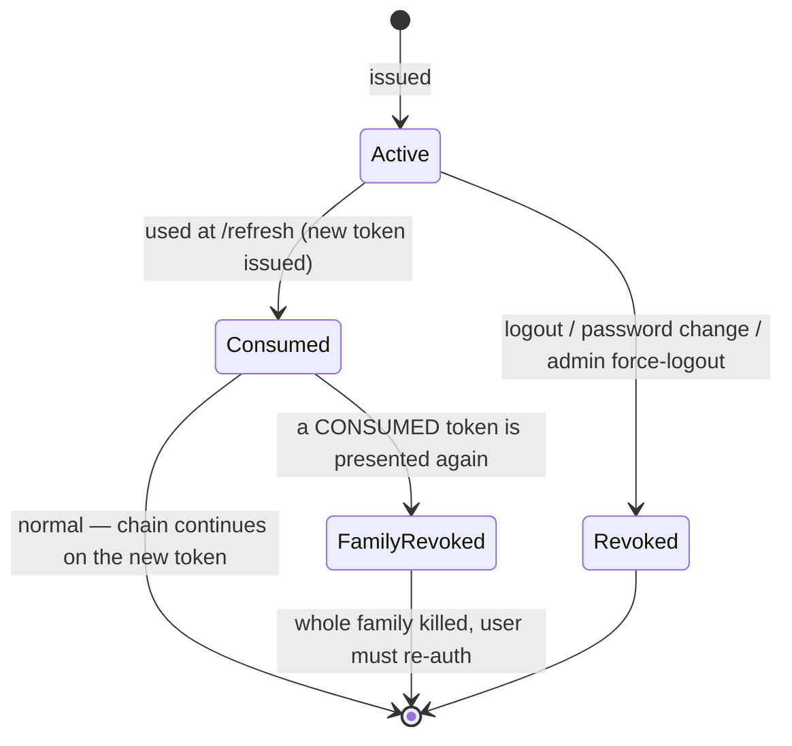

# Authentication System Design — ALLS Solicitors

Design document. **No code.** Defines the token model, lifecycle, Redis and database usage, the auth flows (verification, reset, throttling, device tracking, forced logout), and the middleware/route-protection layer.

Builds on [`ARCHITECTURE.md`](./ARCHITECTURE.md) §4–§5, §13, the `identity` schema in [`DATABASE-DESIGN.md`](./DATABASE-DESIGN.md) §2, the `/auth` surfaces in [`API-DESIGN.md`](./API-DESIGN.md) §1, and the Express `modules/auth/` shape in [`FOLDER-STRUCTURE.md`](./FOLDER-STRUCTURE.md). Stack: Express + Prisma + Redis + JWT.

---

## 1. Principals & mechanisms (the ground rule)

Two authenticated principals, kept structurally separate — conflating them is how portals leak (§4).

| Principal | Table | Primary login | MFA | Refresh lifetime |
|---|---|---|---|---|
| **Staff** (solicitors, admins, editors) | `User` | email + password (**Argon2id**) | **mandatory** (TOTP) | 7d / 30d "remember me" |
| **Client** (portal) | `Client` | **magic-link** (or password) | optional | 7d / 30d "remember me" |

A third, non-account mechanism — the booking **`manageToken`** capability — is covered in `API-DESIGN.md` §4.1 and is out of scope here (it's a hashed, expiring bearer, not a session).

Everything below applies to both principals unless noted; the only real differences are the login step (password+MFA vs magic-link) and which table the session hangs off.

---

## 2. Token model

### 2.1 Access token — JWT, stateless-ish, short-lived

- **Algorithm:** RS256 (asymmetric). A gateway or future service can *verify* with the public key without holding the *signing* key — key separation you can't retrofit cheaply.
- **TTL:** 15 minutes. This is the **revocation-lag ceiling** — the longest a revoked token can still work if Redis were bypassed.
- **Transport:** `Authorization: Bearer <jwt>` header. Never a cookie (so it's CSRF-immune and never auto-sent).
- **Claims (small on purpose):**

```
{ "sub": "<user|client id>", "typ": "staff" | "client",
  "sid": "<session id>", "jti": "<token id>",
  "iat": …, "exp": … }
```

**Roles and permissions are deliberately NOT in the token.** They're resolved per request from a Redis cache keyed by user (§4). Why: embedding them means a role change or a permission revoke doesn't take effect until the token expires. Keeping the token to identity-only makes authorization always-current and keeps the token small.

### 2.2 Refresh token — opaque, stateful, rotating

- **Shape:** 256 bits of CSPRNG randomness. Opaque — carries no claims, means nothing without the DB row.
- **Storage:** **hashed** (SHA-256) in Postgres. A DB dump yields hashes, not usable credentials. SHA-256 (not Argon2) because it's a high-entropy random token we need to *look up by value*, not a low-entropy human password.
- **TTL:** 7 days default; **30 days with "remember me."**
- **Transport:** `httpOnly; Secure; SameSite=Lax` cookie, **path-scoped to `/api/v1/{admin|portal}/auth/refresh`** so it's only ever sent to the refresh endpoint. Not localStorage — an XSS can read localStorage; it cannot read an httpOnly cookie.
- **Rotating + family reuse-detection:** every refresh consumes the presented token and issues a new one in the same **family**. Presenting an already-consumed token is a theft signal → revoke the entire family (§3.2).

---

## 3. Token lifecycle

### 3.1 Happy path

```mermaid
sequenceDiagram
  participant C as Client/Browser
  participant API as Express API
  participant R as Redis
  participant DB as Postgres

  C->>API: POST /auth/login (email, password)
  API->>DB: verify Argon2id hash
  Note over API: staff → issue mfaToken, require TOTP first
  API->>DB: INSERT Session (sid, device info), RefreshToken (hash, familyId)
  API->>R: SET session:{sid} (TTL = refresh lifetime)
  API-->>C: 200 { accessToken (15m) } + Set-Cookie refresh (httpOnly)

  C->>API: GET /admin/... (Bearer access)
  API->>API: verify RS256 signature + exp
  API->>R: EXISTS session:{sid} ?  (revocation check)
  API-->>C: 200 (or 401 if session gone)

  Note over C,API: 15 min later, access expired
  C->>API: POST /auth/refresh (refresh cookie)
  API->>DB: look up SHA-256(token); check not consumed/expired
  API->>DB: mark old consumed; INSERT new RefreshToken (same familyId)
  API->>R: touch session:{sid} lastSeenAt
  API-->>C: 200 { new accessToken } + Set-Cookie new refresh

  C->>API: POST /auth/logout
  API->>R: DEL session:{sid}
  API->>DB: Session.revokedAt = now; revoke refresh family
  API-->>C: 204 + clear cookie
```

**In words:** login mints an access+refresh pair and creates the session (Postgres row for durability/audit, Redis key for hot validity). Each API call verifies the JWT signature **and** checks the Redis session key exists — that second check is what makes revocation immediate. When the 15-minute access token expires, the refresh endpoint rotates the pair. Logout tears down the session everywhere.

### 3.2 Rotation & reuse detection



A refresh token is single-use. The legitimate client always holds the newest token; an attacker who stole an *earlier* one will present a **consumed** token. That presentation is impossible in normal operation, so it's treated as theft: **the entire `familyId` is revoked** and both parties are forced to re-authenticate. This is the property that makes a stolen refresh token a bounded, detectable event rather than a silent persistent compromise.

### 3.3 Revocation — the model

Revocation is **allowlist-based**, not denylist-based. The Redis key `session:{sid}` *is* the license to operate:

- **Valid session** → `session:{sid}` exists in Redis.
- **Revoke** → delete the key (+ mark Postgres `Session.revokedAt`, revoke the refresh family).
- **Auth middleware** requires the key to be present. A deleted key = instant rejection, no 15-minute wait.

One Redis `EXISTS` per request — a cache hit, cheap. The trade (§4 of ARCHITECTURE) is deliberate: "we can't revoke access for 15 minutes" is not acceptable for a firm holding privileged data, so we pay one Redis read to make revocation immediate.

---

## 4. Redis usage

Redis is the **hot, ephemeral, TTL-governed** half of auth. Postgres is the durable, auditable half. Nothing in Redis is a source of truth — it can be rebuilt from Postgres (a cold Redis just forces everyone to re-login, it doesn't lose data).

| Key pattern | Type | TTL | Purpose |
|---|---|---|---|
| `session:{sid}` | hash | = refresh lifetime (7d/30d) | **Session store & revocation allowlist.** Holds `userId, typ, rememberMe, ip, deviceLabel, createdAt, lastSeenAt`. Presence = the session is live |
| `perm:{userId}` | set/string | ~5 min (or busted on role change) | Cached resolved permission set, so authorization doesn't hit Postgres every request |
| `throttle:login:ip:{ip}` | counter | 15 min window | Coarse per-IP failed-login counter |
| `throttle:login:acct:{emailHash}` | counter | 15 min window | Fine per-account failed-login counter |
| `lock:acct:{emailHash}` | flag | progressive (15m → 1h) | Account lockout after N failures |
| `mfa:challenge:{mfaToken}` | hash | 5 min | Pending login state between password step and TOTP step |
| `usersessions:{userId}` | set | — (maintained) | Index of a user's active `sid`s → enables one-shot "revoke all" for password change / admin force-logout |

**Why Redis and not Postgres for these:** they're all either per-request-hot (session validity, permissions) or window-scoped-ephemeral (throttle counters, MFA challenge). Putting throttle counters in Postgres would hammer it on every login attempt including attacks; putting session validity there adds a DB round-trip to every authenticated request. Redis is the right tool and its TTLs do the cleanup for free.

**Password-reset and email-verification tokens live in Postgres, not Redis** (§5) — they're low-frequency, must be auditable, and single-use semantics are cleaner with a durable `consumedAt`.

---

## 5. Database tables (`identity` schema)

Extends `DATABASE-DESIGN.md` §2. Shown here with the auth-relevant columns; the full column list is in that doc.

**`Session`** — one row per login/device. Durable record behind the Redis `session:{sid}`.

| Column | Purpose |
|---|---|
| `id` (= `sid`) | referenced by the JWT `sid` claim and the Redis key |
| `userId` / `clientId` | owning principal (one or the other) |
| `rememberMe` bool | drives refresh TTL and cookie `Max-Age` (§6.3) |
| `ipAddress` inet, `userAgent` text | **device tracking** — captured at creation |
| `deviceLabel` text | parsed "Chrome on macOS" for the user's device list |
| `createdAt`, `lastSeenAt`, `expiresAt` | lifecycle |
| `revokedAt`, `revokedReason` | set on logout / force-logout / password change |

**`RefreshToken`** — rotation chain, hashed. `id`, `sessionId`, `userId`/`clientId`, `tokenHash @unique` (SHA-256), `familyId`, `parentId?`, `consumedAt?`, `expiresAt`, `revokedAt?`, `revokedReason?`. Indexes on `tokenHash`, `familyId`, `sessionId`. (Detail in §2.1 of the DB doc.)

**`MfaCredential`** — `userId`, `type` (`TOTP · RECOVERY_CODE`), `secretEncrypted` (envelope-encrypted), `confirmedAt`, `lastUsedAt`. Staff-mandatory.

**`VerificationToken`** — **new; consolidates** the earlier per-purpose sketches (email-verify, password-reset, client magic-link) into one purpose-typed table. Normalization win: one table, one expiry/consume mechanism, one cleanup job.

| Column | Purpose |
|---|---|
| `id` | |
| `userId` / `clientId` | owning principal |
| `purpose` enum | `EMAIL_VERIFY · PASSWORD_RESET · MAGIC_LINK` |
| `tokenHash @unique` | SHA-256 of the emailed token — never store plaintext |
| `expiresAt` | 24h (verify) / 1h (reset) / 15m (magic-link) |
| `consumedAt?` | single-use enforcement |
| `createdAt`, `ipAddress` | audit |

> Failed-login attempts are **not** a table — they live in Redis (§4). Successful/failed logins, MFA events, password changes, and forced logouts are written to the append-only **`AuditLog`** (`auth.login.success`, `auth.login.failed`, `auth.mfa.verified`, `auth.password.reset`, `auth.session.revoked`), per §10.

---

## 6. The flows

### 6.1 Email verification

New accounts are created **unverified** (`User.status = INVITED` / client `PROSPECT`). A `VerificationToken (EMAIL_VERIFY)` is emailed (24h TTL). Clicking it consumes the token and flips status to `ACTIVE`. Unverified accounts can authenticate only far enough to trigger a re-send. For staff, the invite email *is* the verification link and doubles as first-password setup.

### 6.2 Password reset

1. `POST /auth/password/forgot {email}` → **always `202`** (never reveals whether the email exists — anti-enumeration, §4).
2. If the account exists, issue a `VerificationToken (PASSWORD_RESET)`, 1h TTL, single-use, and email the link.
3. `POST /auth/password/reset {token, newPassword}` → verify token, run the new password through the HIBP k-anonymity breach check, set the Argon2id hash.
4. **Revoke every session for that user** (§6.6) — a reset is exactly when you want all existing sessions killed (the account may already be compromised).

### 6.3 "Remember me"

A login flag that changes **only the refresh side**, never the access token:

| | Remember me OFF | Remember me ON |
|---|---|---|
| Refresh TTL (`RefreshToken.expiresAt`) | 7 days | 30 days |
| Refresh cookie | **session cookie** (no `Max-Age`) → dies on browser close | `Max-Age = 30d` → survives restarts |
| Redis `session:{sid}` TTL | 7 days | 30 days |
| Access token TTL | 15 min (unchanged) | 15 min (unchanged) |

The security posture (15-minute access tokens, rotation, revocation) is identical either way; "remember me" only decides how long the *refresh* capability persists and whether the cookie outlives the browser session.

### 6.4 Login throttling

Two-dimensional, in Redis, to resist both password-spray (many accounts from one IP) and brute-force (one account):

- **Per account:** 5 failed attempts / 15 min → `lock:acct` for 15 min, escalating to 1h on repeat. Returns `423 ACCOUNT_LOCKED`.
- **Per IP:** ~20 failed attempts / 15 min → `429 RATE_LIMITED` + `Retry-After`.
- Counters key off a **hash of the email** (not plaintext) and reset on a successful login.
- Responses stay **uniform** (`INVALID_CREDENTIALS` for bad email *or* password) so throttling never doubles as an account oracle.
- **Trust-proxy configured correctly** (§13) — otherwise every attempt keys off the load-balancer IP and the whole internet throttles as one user.

### 6.5 Device tracking

Each login creates one `Session` capturing `ipAddress`, `userAgent`, and a parsed `deviceLabel`, with `createdAt`/`lastSeenAt`. This powers:
- `GET /auth/me/sessions` (and admin `GET /users/:id/sessions`) → the user's active-device list.
- `lastSeenAt` refreshed on each successful refresh (cheap Redis + periodic Postgres write).
- A signal for anomaly detection later (new-country login → step-up MFA), designed-for but not built phase one.

### 6.6 Session invalidation & admin forced logout

All of these are the **same primitive** — revoke one or more sessions — applied in different triggers:

| Trigger | Scope | Mechanism |
|---|---|---|
| User logs out | this session | `DEL session:{sid}` + `Session.revokedAt` + revoke refresh family |
| User "log out everywhere" | all their sessions | iterate `usersessions:{userId}` → revoke each |
| Password change / reset | all their sessions | same as above (forces global re-login) |
| **Admin forced logout** | a target user's session(s) | admin endpoint (`DELETE /admin/users/:id/sessions`, perm `user:manage-roles`) revokes one or all — for a stolen device or a staff termination |
| Account suspended/disabled | all sessions | revoke all + block new logins by `status` |

Because validity is the Redis allowlist, every one of these takes effect **within the ≤15-minute access-token window at worst, and immediately for anything that re-checks the session** — and no revoked refresh family can mint new tokens.

---

## 7. Middleware & route protection

Three layers, applied in order. **Deny by default** — the app requires auth everywhere and routes *opt out*, so a forgotten guard fails **closed** (§5, §14).

### 7.1 Authentication middleware (`authenticate`)

Runs on every non-public route. Steps:
1. Extract the Bearer token; **verify the RS256 signature and `exp`** with the public key.
2. **Check `session:{sid}` exists in Redis** — the revocation gate. Missing → `401`.
3. Confirm `typ` matches the surface (a client token on an `/admin` route → `401`).
4. Attach `req.principal = { id, sid, typ }`. No DB hit on the hot path.

Failure → `401 UNAUTHENTICATED` (RFC 9457 problem+json). The **refresh route** uses a *separate* handler that reads the httpOnly cookie, not this middleware.

### 7.2 Authorization middleware (`authorize`)

Runs after `authenticate`, on routes that declare a required permission.
1. Load the principal's permission set from `perm:{userId}` (Redis; rebuilt from Postgres on miss or role change).
2. Require the route's permission key (`booking:read`, `content:publish`, …) — **permissions, not roles** (§5).
3. For resource-scoped routes, build the CASL ability from `(role, scope)` grants and **push the conditions into the Prisma `where`** — authorization becomes a query predicate, which structurally prevents IDOR (never fetch-then-check).

Failure → `403 FORBIDDEN`. Portal routes skip explicit permissions but are **implicitly scoped to `clientId = self`** in the same where-clause manner.

### 7.3 Supporting middleware

| Middleware | Role |
|---|---|
| `requireMfa` | staff routes: reject tokens from a session that hasn't completed the TOTP step |
| `requireFreshSession` | sensitive ops (password change, MFA re-enroll): require a session authenticated within N minutes, else re-prompt |
| `rateLimit(policy)` | Redis-backed throttling per §6.4 / §13; strict on `/auth/login`, `/auth/*/forgot` |
| `validate(schema)` | Zod boundary validation before the controller (from `validation/`) |
| `requestId` | correlation id into logs + job payloads |
| `errorHandler` | maps `AppError`/domain codes → RFC 9457, never leaks internals |

### 7.4 Route protection by surface

Wiring lives in `routes/v1.ts` (the composition point, `FOLDER-STRUCTURE.md`):

- **`/api/v1/public/*`** — `authenticate` **not** applied; routes are open (or use the `manageToken` capability middleware). Heaviest `rateLimit`.
- **`/api/v1/portal/*`** — `authenticate` (client `typ`) → self-scoped queries. Moderate `rateLimit`.
- **`/api/v1/admin/*`** — `authenticate` (staff `typ`) → `requireMfa` → `authorize(permission)`. Optional IP allowlist. `requireFreshSession` on the sensitive subset.

A route is protected by *composing* these — never by an ad-hoc `if` inside a controller. That's what keeps "forgot to protect an endpoint" from being possible: the default router requires `authenticate`, and only an explicit `public` mount removes it.

---

## 8. Security headers & transport

Applied globally (via `helmet` + config), independent of the per-route guards:

| Control | Setting | Why |
|---|---|---|
| **HSTS** | `max-age` ≥ 1y, `includeSubDomains`, `preload` | force HTTPS, protect against SSL-strip |
| **CSP** | strict; **nonce-based**, not `unsafe-inline` | the frontend's `JsonLd` emits inline `<script type="application/ld+json">` — needs nonces (§13) |
| **X-Content-Type-Options** | `nosniff` | stop MIME-sniffing |
| **X-Frame-Options / frame-ancestors** | `DENY` / `'none'` | clickjacking |
| **Referrer-Policy** | `strict-origin-when-cross-origin` | don't leak URLs |
| **Permissions-Policy** | deny unused features | reduce attack surface |
| `X-Powered-By` | **removed** | don't advertise Express |
| **CORS** | exact-origin allowlist; credentials only on portal/admin | no wildcard with cookies |
| **CSRF** | `SameSite=Lax` + **double-submit token on the refresh-cookie route** | bearer routes are CSRF-immune; the cookie route isn't |
| **Cookies** | `httpOnly; Secure; SameSite=Lax`, path-scoped | refresh token can't be read by JS or sent cross-site |
| **TLS** | 1.2+ only | baseline |

---

## 9. Summary — how the requirements map

| Requirement | Where it's handled |
|---|---|
| JWT access tokens | RS256, 15-min, identity-only claims (§2.1) |
| Refresh tokens | opaque, SHA-256-hashed, httpOnly cookie (§2.2) |
| Rotation | single-use, per-family, on every `/refresh` (§3.2) |
| Revocation | Redis allowlist `session:{sid}` + refresh-family revoke (§3.3) |
| Redis session storage | `session:{sid}` as store + revocation gate (§4) |
| Password reset | `VerificationToken(PASSWORD_RESET)`, 1h, revokes all sessions (§6.2) |
| Email verification | `VerificationToken(EMAIL_VERIFY)`, 24h, status flip (§6.1) |
| Remember me | refresh TTL + cookie Max-Age only (§6.3) |
| Login throttling | two-dimensional Redis counters + lockout (§6.4) |
| Device tracking | `Session` ip/userAgent/deviceLabel + session list (§6.5) |
| Session invalidation | the revoke primitive, many triggers (§6.6) |
| Admin forced logout | admin revoke via `usersessions:{userId}` (§6.6) |
| Security headers | helmet/CSP/HSTS/CORS/CSRF (§8) |
| Middleware & route protection | authenticate → authorize → scope, deny-by-default (§7) |
