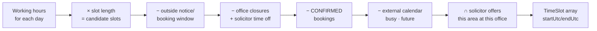
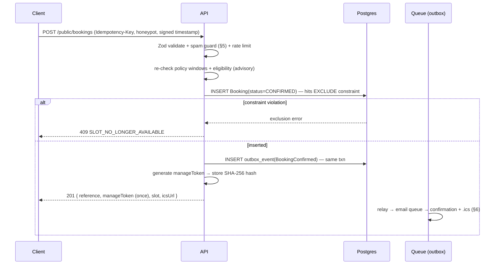
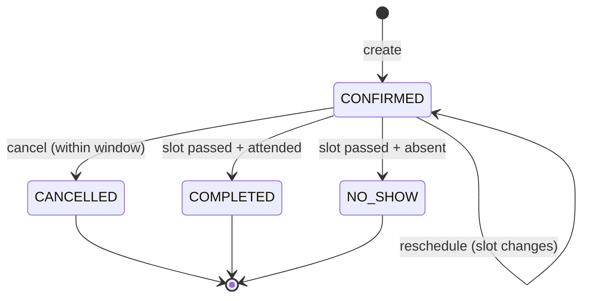
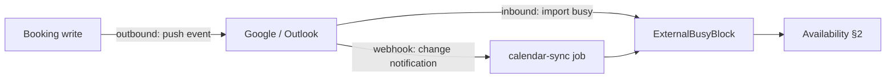

# Appointment Booking System Design — ALLS Solicitors

Design document. **No implementation.** Defines the correctness model, database structure, availability computation, business rules, booking/cancel/reschedule flows, email, the future calendar-integration seam, and the API.

Builds on [`ARCHITECTURE.md`](./ARCHITECTURE.md) §6 (the `EXCLUDE` constraint), §8 (reminders/outbox), the `Booking` table in [`DATABASE-DESIGN.md`](./DATABASE-DESIGN.md) §3.2, the endpoints in [`API-DESIGN.md`](./API-DESIGN.md) §4, and the existing frontend booking domain (`createBooking`, `cancelBooking`, `rescheduleBooking`, `getAvailability`, availability computation, `WorkingHours`, `TimeSlot`, the `DomainError` codes). Stack: **Express + TypeScript** (canonical).

---

## 0. The correctness claim everything rests on

A booking system has exactly one job it must never get wrong: **two clients must never both hold the same solicitor at the same time.** Everything else is UX around that invariant.

**An application-level "is the slot free?" check cannot guarantee it.** Two requests can both read "free" in the millisecond between check and insert. Under concurrency, only the database can enforce the invariant — via a Postgres **`EXCLUDE` constraint** (ARCHITECTURE §6):

```sql
ALTER TABLE business."Booking" ADD CONSTRAINT booking_no_overlap
  EXCLUDE USING gist (
    "solicitorId" WITH =,
    tstzrange("slotStartUtc", "slotEndUtc") WITH &&
  ) WHERE (status = 'CONFIRMED');
```

- **`WHERE status = 'CONFIRMED'`** is load-bearing: without it a *cancelled* booking blocks its slot forever (ARCHITECTURE appendix #2). The constraint applies only to live bookings, so a cancelled slot is immediately rebookable.
- **The application check still exists** — but as *UX*, to show availability and return a friendly error *most* of the time. The constraint is the *guarantee*, for the race the check can't see.
- **The one mandatory test** (ARCHITECTURE §16): fire N concurrent `createBooking` calls for the same solicitor+slot; assert **exactly one** succeeds and the rest get `SLOT_NO_LONGER_AVAILABLE`. If that test doesn't exist, the constraint is just a comment.

Read the rest of this document with that split in mind: **availability computation and business rules are advisory; the `EXCLUDE` constraint is authoritative.**

---

## 1. Database structure

### 1.1 The core: `Booking`

From DATABASE-DESIGN §3.2, the salient columns:

| Column | Role |
|---|---|
| `id` uuid | PK (UUIDv7) |
| `reference` citext unique | human-friendly `ALLS-xxxxxx` for support/email |
| `manageTokenHash` text unique | **hashed** capability token for the public manage link (AUTH §1; ARCHITECTURE appendix #3) |
| `manageTokenExpiresAt` | capability expires at slot-end + cancellation window |
| `status` enum | `CONFIRMED · CANCELLED · COMPLETED · NO_SHOW` (§4) |
| `solicitorId`, `practiceAreaId`, `officeId` | FKs → the CMS catalog (the assignment) |
| `clientId?` | FK → `Client` (null for anonymous public bookings) |
| `slotStartUtc`, `slotEndUtc` timestamptz | **always UTC** |
| `displayTimeZone` text | IANA zone the client selected, so emails show the time they expect |
| `clientName/Email/Phone`, `clientNotes` | inline contact; `clientNotes` **envelope-encrypted** (ARCHITECTURE §6) |
| `reminderSentAt?` | claim-before-send target (§6, ARCHITECTURE appendix #4) |
| `cancelledAt?`, `cancelReason?` | |
| `rescheduledFromStart/End?` | lightweight single-reschedule trail |
| timestamps + `deletedAt` | soft delete governed by retention |

Indexes: `(solicitorId, slotStartUtc)` (availability hot path), `(slotStartUtc)`, partial `(reminderSentAt) WHERE reminderSentAt IS NULL AND status='CONFIRMED'`, `(clientEmail)`, `(clientId)`, `(status)`, plus the `EXCLUDE` (§0).

### 1.2 What feeds availability (the scheduling data)

Availability is **not** stored — it's *computed* (§2) from these inputs:

| Source | Table | Role |
|---|---|---|
| Recurring weekly hours | `Solicitor.workingHours` (jsonb) | `{ "1": {start,end}, … }` per day-of-week, in office wall-clock time |
| Which offices, which days | `SolicitorOffice` (M:N) | a solicitor's availability at an office (DB §4.1) |
| Which services a solicitor offers | `SolicitorPracticeArea` (M:N) | you can only book a solicitor for an area they handle |
| Slot length | `PracticeArea.durationMinutes` | defines the slot size for that appointment type |
| Office timezone | `Office.timeZone` | converts wall-clock hours ↔ UTC |
| **Solicitor time off** | **`SolicitorTimeOff`** *(new)* | `solicitorId, startUtc, endUtc, type (BLACKOUT|EXTRA), reason` — holidays, court dates, ad-hoc closures subtract from (or add to) availability |
| **Office/firm closures** | **`OfficeClosure`** *(new)* | `officeId?, date, name` — bank holidays, office-specific closures (null officeId = firm-wide) |
| Existing bookings | `Booking WHERE status='CONFIRMED'` | occupied slots |
| **External calendar busy** *(future)* | **`ExternalBusyBlock`** (§7) | imported busy times from Google/Outlook |

Two new small tables (`SolicitorTimeOff`, `OfficeClosure`) are the realistic additions the seed data lacked — a booking system that can't represent "she's on holiday next week" isn't usable. Both are simple, indexed on `(solicitorId, startUtc)` / `(officeId, date)`.

### 1.3 Booking policy

`BookingPolicy` — firm-level (optionally per practice area) config, not hardcoded: `noticeWindowHours` (min lead), `bookingWindowDays` (max horizon), `cancellationWindowHours`, `slotBufferMinutes`. Read at availability + booking time (§3). Stored as a small config table (or firm settings) so the firm can tune it without a deploy.

### 1.4 Optional history normalization

DATABASE-DESIGN keeps a **lightweight** single-reschedule trail (`rescheduledFromStart/End`). Full history (every status change, every reschedule) is answered by the append-only **`AuditLog`** (`booking.created/cancelled/rescheduled/reassigned`), not a bespoke table — so no separate `BookingEvent` table is introduced. Add one only if the portal needs to *render* a timeline cheaply.

---

## 2. Availability computation

Availability for a `(solicitor, practiceArea, office, dateRange)` is a **pipeline of set operations**, producing `TimeSlot[]`:



Step by step:
1. **Working hours → candidate slots.** For each day in the range, read the solicitor's `workingHours` for that weekday (office wall-clock), and tile it into slots of `PracticeArea.durationMinutes` (+ `slotBufferMinutes`). **Convert to UTC** using `Office.timeZone` — DST-correct, because the wall-clock hours are fixed but their UTC offset shifts twice a year.
2. **Window filter.** Drop slots starting sooner than `noticeWindowHours` from now (`OUTSIDE_NOTICE_WINDOW`) or further than `bookingWindowDays` (`OUTSIDE_BOOKING_WINDOW`).
3. **Subtract closures & time off.** Remove slots overlapping an `OfficeClosure` or a `SolicitorTimeOff(BLACKOUT)`; add any `EXTRA` availability.
4. **Subtract existing bookings.** Remove slots overlapping this solicitor's `CONFIRMED` bookings.
5. **Subtract external busy** *(future, §7)* — same set-subtraction, one more source.
6. **Eligibility filter.** Only if the solicitor offers this practice area (`SolicitorPracticeArea`) and works this office (`SolicitorOffice`).

**Caching:** the result is cached in Redis per `(solicitorId, day)` (INFRA §8; ARCHITECTURE §18 — this is *the* hot path). **Invalidated on any booking write, time-off change, or external-calendar update** for that solicitor/day. The cache absorbs the read volume; Postgres stays the source of truth.

**"Any available solicitor" mode** (auto-assign, §3.2) runs this per candidate solicitor for the area and unions the results, tagging each slot with which solicitor(s) can serve it.

---

## 3. Booking flows

### 3.1 Public booking (anonymous)

The wizard the frontend already drives: **practice area → solicitor (or "any") → office → slot → details**. On submit:



Key properties: **immediately `CONFIRMED`** (no approval step — the firm's model); the raw `manageToken` is returned **once** and never again (only its hash is stored); the confirmation email is **guaranteed to eventually send** via the outbox even though the HTTP response doesn't wait for it (ARCHITECTURE §8 — "notification failures must never undo a persisted booking").

### 3.2 Solicitor assignment

Three modes, one column (`Booking.solicitorId`):

| Mode | Who chooses | How |
|---|---|---|
| **Client-selected** | public client | picks a named solicitor; availability is that solicitor's |
| **Auto-assign ("any available")** | system | client picks the *area*; availability unions all eligible solicitors; on booking, assign the one who owns the chosen slot (tie-break by least-loaded / round-robin) |
| **Admin-assigned** | receptionist/admin | staff books on behalf and assigns explicitly; can **reassign** later (§8) |

Auto-assign resolves the concrete `solicitorId` **before** the insert, so the `EXCLUDE` constraint still applies to a specific solicitor. Reassignment is an admin action that moves the booking to another solicitor (re-checking their availability + the constraint).

### 3.3 Admin booking

`POST /admin/bookings` — staff create on behalf of a client (phone/walk-in). Differences from public: authenticated (`booking:create`), **may attach a `clientId`**, may **override** soft policy windows (e.g. book inside the notice window for a walk-in) with an audited reason, and skips the spam guard. The `EXCLUDE` constraint is **never** overridable — even staff can't double-book.

### 3.4 Portal booking (future)

Logged-in clients book via `/portal/bookings` — same engine, `clientId` from the session, no manage-token needed (they authenticate).

---

## 4. Appointment status



- **`CONFIRMED`** — the only status that occupies a slot (the `EXCLUDE` predicate).
- **`CANCELLED`** — frees the slot immediately; retained (soft), not deleted.
- **`COMPLETED` / `NO_SHOW`** — terminal outcomes set after the slot, by staff or an automated post-slot job. These free the slot too (only `CONFIRMED` is excluded) but are distinguished for reporting.
- **Reschedule keeps `CONFIRMED`** and moves the slot (§8) — it's not a new status.
- An optional `PENDING` (approval-required) status is deliberately **out of scope** — the firm confirms immediately; add it only if an approval workflow is introduced.

Transitions are enforced in the service (a `CANCELLED` booking can't be `COMPLETED`); illegal transitions → `409 INVALID_STATUS_TRANSITION`.

---

## 5. Business rules

All read from `BookingPolicy` (§1.3), not hardcoded — the firm tunes them.

| Rule | Meaning | Error when violated |
|---|---|---|
| **Notice window** | must book ≥ `noticeWindowHours` ahead (staff prep time) | `OUTSIDE_NOTICE_WINDOW` (422) |
| **Booking window** | must book ≤ `bookingWindowDays` ahead (don't take bookings 2 years out) | `OUTSIDE_BOOKING_WINDOW` (422) |
| **Cancellation window** | may cancel/reschedule up to `cancellationWindowHours` before the slot | `OUTSIDE_CANCELLATION_WINDOW` (422) |
| **Slot integrity** | no overlap per solicitor | `SLOT_NO_LONGER_AVAILABLE` (409) — the constraint |
| **Eligibility** | solicitor must offer the area and work the office | `SOLICITOR_UNAVAILABLE` (422) |
| **Duration** | slot length = the area's `durationMinutes` (+ buffer) | (enforced by generation) |
| **Ownership** | only the manage-token holder (or staff) can mutate a booking | uniform `404` on bad/expired token |
| **Spam (public only)** | honeypot + **HMAC-signed** render timestamp + Redis rate limit | `SPAM_REJECTED` (422) / `RATE_LIMITED` (429) |
| **Idempotency** | `Idempotency-Key` on `POST /bookings` → replay stored response | (dedupe, not an error) |

The `renderedAtMs` timing signal is **server-HMAC-signed** so it can't be forged (ARCHITECTURE appendix #5 / §12). Staff bookings bypass spam rules and *may* override the notice/cancellation windows with an audited reason — never the slot-integrity constraint.

---

## 6. Email confirmations & reminders

- **Confirmation** — on `BookingConfirmed`, a worker composes the email + a `.ics` attachment (the frontend's `emailComposer`/calendar helpers move as-is, ARCHITECTURE §9) and sends via the `email` queue. Times render in the client's `displayTimeZone`.
- **Delivery guarantee** — via the **transactional outbox** (§3.1): the booking commits regardless, and the email is guaranteed to eventually send (ARCHITECTURE §8). Tracked in `Notification`/`NotificationEvent` (DB §3.4) so "did they get it?" is answerable.
- **Reminders** — a BullMQ **repeatable hourly job** finds bookings due for a reminder and sends, with **claim-before-send** (`UPDATE … SET reminderSentAt=now() WHERE id=$1 AND reminderSentAt IS NULL RETURNING *`) so two workers can't double-send (ARCHITECTURE §8, appendix #4). Replaces the deleted Vercel cron; fires **once cluster-wide**.
- **Cancellation / reschedule emails** — same pipeline, triggered by those events, with an updated `.ics`.
- **Reminders never carry matter detail** (PECR/confidentiality, ARCHITECTURE §9) — "You have an appointment tomorrow at 2pm," never why.

---

## 7. Future calendar integration (Google + Outlook) — the seam

Not built now, but the seam is designed so availability and booking writes already have the hook. **This is genuinely hard** (two-way sync, conflict resolution, token refresh, watch renewal — ARCHITECTURE §18); the design isolates it.

### 7.1 Tables (future)

| Table | Holds |
|---|---|
| **`CalendarConnection`** | `id, solicitorId, provider (GOOGLE|OUTLOOK), accountEmail, accessTokenEnc, refreshTokenEnc, tokenExpiresAt, scopes, syncToken, watchChannelId, watchExpiresAt, status` — **OAuth tokens envelope-encrypted** (high-value secrets, ARCHITECTURE §18), one module isolated |
| **`ExternalBusyBlock`** | `id, connectionId, externalEventId, startUtc, endUtc, transparency` — imported busy times that **subtract from availability** (§2 step 5) |
| **`BookingCalendarRef`** | `bookingId, connectionId, externalEventId, syncStatus` — maps our booking → the event we pushed into the solicitor's calendar |

### 7.2 Two directions



- **Inbound (import busy)** — the solicitor's personal/court calendar events become `ExternalBusyBlock`s, so the system won't offer a slot when they're already busy elsewhere. This is the higher-value direction (prevents real double-booking of a person).
- **Outbound (push booking)** — a `CONFIRMED` booking becomes an event in the solicitor's calendar; cancel/reschedule updates/deletes it. Tracked via `BookingCalendarRef`.

### 7.3 Mechanics (why it's isolated)

- **Behind a `CalendarSyncPort`** (the port ARCHITECTURE §18 / `prisma/README` already predicted), with `GoogleAdapter` / `OutlookAdapter`. The rest of the system knows only "busy blocks" and "emit booking event" — provider specifics don't leak.
- **All work on the `calendar-sync` BullMQ queue** — token refresh, incremental sync (`syncToken`), **watch-channel renewal** (Google channels / Outlook subscriptions expire and must be re-registered), and a **reconciliation sweep** for drift.
- **Conflict resolution policy:** our system is the source of truth for bookings *it* created; the external calendar is the source of truth for the solicitor's *personal* events. A booking-slot conflict discovered on import is surfaced to staff, never silently resolved.
- **The seam is already in place today:** availability (§2) subtracts "busy blocks" from a **pluggable set of sources** — external calendars are just one more source; and booking writes already emit domain events — the outbound sync is a new *subscriber*, not an edit to `createBooking`.

---

## 8. Cancellation & rescheduling

**Cancellation:**
- Via manage token (`POST /public/bookings/manage/:token/cancel`) or staff (`POST /admin/bookings/:id/cancel`).
- Allowed only within the **cancellation window** (`OUTSIDE_CANCELLATION_WINDOW` otherwise; staff may override with a reason).
- Sets `status=CANCELLED`, `cancelledAt`, `cancelReason` → **frees the slot instantly** (the `EXCLUDE` predicate stops applying) → emits `BookingCancelled` (email + calendar delete + availability cache bust).
- Idempotent: cancelling an already-cancelled booking → `409 BOOKING_ALREADY_CANCELLED` (or a no-op replay).

**Rescheduling** (the interesting one — it's a move under the same constraint):
- `rescheduleIfSlotFree` (existing domain logic): attempt the `UPDATE` to the new slot; the `EXCLUDE` constraint enforces the new slot is free; **catch the violation → `SLOT_NO_LONGER_AVAILABLE`** (ARCHITECTURE §6). This is the same guarantee as create, applied to a move.
- Keeps `status=CONFIRMED`, records `rescheduledFromStart/End`, re-checks the notice/booking windows for the *new* slot.
- Emits `BookingRescheduled` → updated `.ics` + calendar update + cache bust (old and new day).
- **Reassignment** (`POST /admin/bookings/:id/reassign`) is a reschedule variant: change `solicitorId` (and optionally the slot), re-checking the new solicitor's availability + constraint.

---

## 9. API

From API-DESIGN §4, with the booking-specific detail. Three surfaces.

### 9.1 Public — `/api/v1/public/*`
| Method | Route | Notes |
|---|---|---|
| GET | `/availability` | `?practiceArea&solicitor?&office&from&to&timeZone`; `solicitor` omitted = auto-assign union; ≤31-day span; cached/CDN-able, bust on write |
| POST | `/bookings` | `Idempotency-Key` required; body = `CreateBookingDto` (§3.1); `201 { reference, manageToken, slot, icsUrl }` |
| GET | `/bookings/manage/:manageToken` | capability-token view; uniform `404` on miss/expiry |
| POST | `/bookings/manage/:manageToken/cancel` | §8 |
| POST | `/bookings/manage/:manageToken/reschedule` | §8; `409` if new slot taken |

### 9.2 Admin — `/api/v1/admin/*` (perms: `booking:*`)
| Method | Route | Notes |
|---|---|---|
| GET | `/bookings` | cursor; filter `status/solicitorId/officeId/practiceAreaId/from/to`; search `name/email/reference`; sort `-slotStartUtc` |
| GET | `/bookings/:id` | |
| POST | `/bookings` | staff on-behalf; assign solicitor; may override soft windows (audited) |
| PATCH | `/bookings/:id` | status / notes |
| POST | `/bookings/:id/cancel` · `/reschedule` · `/reassign` | §8 |
| GET | `/availability` | staff cross-solicitor view (all solicitors, an office/day) |
| PUT | `/solicitors/:id/working-hours` | manage recurring hours (Solicitors module) |
| POST·DELETE | `/solicitors/:id/time-off` | `SolicitorTimeOff` CRUD (§1.2) |
| POST·DELETE | `/offices/:id/closures` | `OfficeClosure` CRUD |

### 9.3 Portal — `/api/v1/portal/*` (client, self-scoped)
| Method | Route | Notes |
|---|---|---|
| GET | `/bookings` | own bookings only (scope in `where`, not post-check) |
| GET | `/bookings/:id` | uniform `404` if not theirs |

**Error contract** (unchanged frontend codes, §5): `VALIDATION_FAILED` 400 · `SPAM_REJECTED` 422 · `RATE_LIMITED` 429 · `SLOT_NO_LONGER_AVAILABLE` **409** · `OUTSIDE_NOTICE_WINDOW`/`OUTSIDE_BOOKING_WINDOW`/`OUTSIDE_CANCELLATION_WINDOW`/`SOLICITOR_UNAVAILABLE` 422 · uniform `404`.

---

## 10. Summary — requirement → section

| Requirement | Where |
|---|---|
| Public booking | §3.1, §9.1 |
| Admin booking | §3.3, §9.2 |
| Solicitor assignment | §3.2 (3 modes) |
| Availability | §2 (computation pipeline) |
| Working hours | §1.2, §2 step 1 |
| Office locations | §1.2 (timezone, eligibility), `Office` |
| Appointment status | §4 (state machine) |
| Email confirmations | §6 (outbox + `.ics` + reminders) |
| Cancellation | §8 |
| Rescheduling | §8 (constraint-enforced move) |
| Conflict detection | §0 (the `EXCLUDE` constraint — authoritative) |
| Google Calendar (future) | §7 |
| Outlook (future) | §7 |
| Database structure | §1 |
| API | §9 |
| Business rules | §5 |
