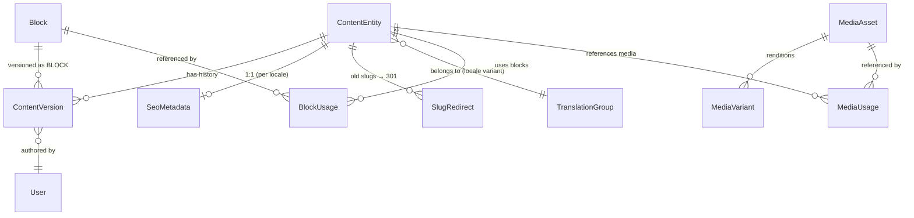

# CMS Architecture — ALLS Solicitors

Design document. **No implementation.** Defines the content model, editorial workflow (drafts, versioning, publishing, scheduling), reusable blocks, slug/SEO/media handling, the multilingual seam, the database relationships, and the API split.

Builds on [`DATABASE-DESIGN.md`](./DATABASE-DESIGN.md) §4 (the `cms` schema), [`API-DESIGN.md`](./API-DESIGN.md) §6–§14 (CMS endpoints), and [`ARCHITECTURE.md`](./ARCHITECTURE.md) §18 (build-vs-buy). Stack: **Express + TypeScript** (canonical, per the ARCHITECTURE stack banner).

---

## 0. The opening decision: this feature set is the "buy" signal

ARCHITECTURE §18 recommended **building a lean `content` module** and named the exact condition to revisit it:

> *"Revisit the moment editors ask for draft preview or scheduled publishing — that's the signal that you're rebuilding Payload badly."*

**This brief is that signal, and then some** — drafts, versioning, scheduled publishing, reusable blocks, and multilingual are, together, most of what a headless CMS *is*. Building all of it well is months of work orthogonal to the firm's actual product.

**Recommendation:** seriously evaluate **Payload CMS** (TypeScript-native, Postgres-backed, self-hostable in the UK) before committing to build. It gives drafts, versions, scheduled publish, block fields, localization, and a media library **out of the box**, on the same database and language. The cost is a second framework's ops surface (ARCHITECTURE §18) — real, but smaller than reimplementing this list.

**This document designs the *build* path anyway**, because (a) the brief asks for the architecture, (b) it's the reference we'd measure Payload against, and (c) if the firm's needs stay lean, a **deliberately minimal version-aware core** — not a Payload clone — is defensible. The design below is that minimal core. Its guiding constraint (§13): **build the workflow primitives, not a page-builder.**

---

## 1. The layered model — identity vs. editorial state

The single most important structural decision. Every editorial content type is split into **two layers**:

| Layer | Holds | Read by | Shape |
|---|---|---|---|
| **Published projection** (the entity row) | stable identity (`id`, `slug`, `displayOrder`, relationships) **+ the currently-live field values** | the **public delivery API** — fast, cached, CDN-fronted | relational (typed columns) |
| **Editorial versions** (`ContentVersion`) | every saved draft + published snapshot, as `data jsonb`, with author/note/timestamp | the **authoring API** only | snapshot (jsonb) |

**Why split them:**
- **Public reads never parse editorial state.** The delivery API reads the projection's typed columns — no jsonb parsing, no "is this the published version?" logic on the hot path. This is what keeps the public site fast and cacheable (ARCHITECTURE §18).
- **Editing a draft never touches the live site.** A draft is a new `ContentVersion(DRAFT)`; the projection is unchanged until **publish** promotes the version's `data` into it. That's how you get draft preview without a staging environment.
- **The trade-off, stated:** the draft/version layer is jsonb snapshots, so it doesn't carry relational FK integrity *while in draft* (a draft referencing a since-deleted media asset is validated at publish, not by the DB). That's the deliberate cost of one generic versioning mechanism instead of shadow tables per type. Acceptable — publish-time validation catches it, and the projection *is* relational.

**Not every content type gets this workflow** (§12). Reviews and Media have their own lifecycles; forcing drafts/versions on a moderation queue or a binary upload would be ceremony.

---

## 2. Content lifecycle & states

```mermaid
stateDiagram-v2
  [*] --> Draft: create
  Draft --> Draft: save (new version)
  Draft --> Scheduled: schedule(publishAt)
  Draft --> Published: publish now
  Scheduled --> Published: job fires at publishAt
  Scheduled --> Draft: cancel schedule
  Published --> Draft: edit (new draft version; live stays up)
  Published --> Unpublished: unpublish
  Unpublished --> Published: re-publish
  Published --> Archived: archive
  Archived --> [*]
```



- **Draft** — has a latest unpublished version; not on the public site (or the *previous* published projection stays live if it was ever published).
- **Scheduled** — a version is approved and will auto-publish at `publishAt` (§5).
- **Published** — a version's data is live in the projection.
- **Unpublished / Archived** — removed from public delivery; history retained.

Crucially, **editing a Published item creates a new Draft version while the live projection stays untouched** — the public never sees work-in-progress.

---

## 3. Drafts & versioning

**`ContentVersion`** — one generic table serving every versioned type.

| Column | Purpose |
|---|---|
| `id` | uuid |
| `contentType` | enum (`PRACTICE_AREA · SOLICITOR · BLOG_POST · FAQ · OFFICE · HOMEPAGE_SECTION · BLOCK`) |
| `contentId` | the entity's `id` (the projection row) |
| `locale` | BCP-47 (`en-GB` default) — the multilingual seam (§9) |
| `version` | monotonic int per `(contentType, contentId, locale)` |
| `data` | jsonb snapshot of the editable fields |
| `status` | `DRAFT · PUBLISHED · SUPERSEDED` |
| `authorId` | FK → `User` (who saved it) |
| `note` | optional changelog message |
| `createdAt` | |

- **A draft save** inserts a new `DRAFT` version (or updates the current draft in place, per an autosave policy). The projection is not touched.
- **History = every version.** Rollback is "publish version N again" → creates a fresh version from N's `data` and promotes it (history stays linear and auditable; you never rewrite the past).
- **Diffing** two versions is a jsonb comparison — powers "what changed" in the editor.
- **Retention:** old `SUPERSEDED` versions prune on a schedule (keep last N + all published-in-last-Y). Versions are editorial history, not the legal audit trail — that's `AuditLog` (§11, DB §5).

The entity/projection row carries the workflow pointers: `status`, `publishedVersionId`, `latestVersionId`, `publishAt?`, `publishedAt?`.

---

## 4. Publishing

Publish is a **promotion**: copy the chosen version's `data` into the projection's typed columns, in one transaction.

```
publish(contentId, versionId):
  validate version.data against the type's schema + referential checks (media exists, FKs resolve)
  BEGIN
    projection ← version.data            # write typed columns
    version.status = PUBLISHED           # previous published → SUPERSEDED
    projection.status = PUBLISHED, publishedVersionId = version.id, publishedAt = now
  COMMIT
  emit ContentPublished(contentType, id, slug)   # → ISR revalidation + cache bust
```

- **Validation happens at publish**, not draft — the one place the jsonb draft becomes a relational, referentially-sound row.
- **Revalidation:** publishing emits a domain event; a `cms-revalidate` job calls Next's `revalidateTag`/`revalidatePath` (ARCHITECTURE §18) and busts the Redis + CDN caches for that resource (INFRA §8). This is what keeps the site statically fast *and* fresh — the piece people forget.
- **Unpublish** clears the projection's public visibility (soft — data retained) and revalidates.

---

## 5. Scheduled publishing

- Scheduling sets `projection.status = SCHEDULED` and `publishAt` (stored UTC; editor picks in the firm's timezone).
- **A BullMQ delayed job** (`jobId = publish:{contentId}:{versionId}`, natural-key deduped) fires at `publishAt` and runs the same `publish()` path. A companion **hourly sweep** repeatable job catches anything missed (clock skew, downtime) by promoting any `SCHEDULED` item whose `publishAt <= now`.
- **Cluster-safe:** BullMQ coordinates through Redis so N API replicas schedule/fire **once**, not N times (the same property that fixed reminders, ARCHITECTURE §8).
- **Rescheduling** removes the delayed job and re-adds it; **cancelling** returns the item to `DRAFT`.
- Optional `unpublishAt` (content with an expiry — a time-limited notice) uses the same mechanism in reverse.

---

## 6. Reusable blocks

**Content bodies are block-structured** (the blog `body[]` and homepage sections already are, in the seed data). A block is a typed content node; a body is an **ordered list of blocks**.

Two kinds of block:
- **Inline block** — lives inside its content's `data` jsonb (a paragraph in one post). Not shared.
- **Reusable block** — a row in the **`Block`** library, referenced by many contents via a reference node `{ "type": "ref", "blockId": "…" }`. Edit once → every referencing page updates on the block's next publish.

**`Block`** (library) — `id`, `key @unique`, `type` (see registry), `name`, versioned exactly like any other content (`ContentVersion.contentType = BLOCK`), so a shared CTA has drafts/publish/history too.

**Block type registry** — a fixed, schema-validated vocabulary (each type has a Zod schema in `packages/contracts`, so blocks validate and self-document): `RichText · Image · Gallery · CTA · Quote · StatsRow · FAQAccordion · SolicitorCard · PracticeAreaGrid · Embed`. Closed set on purpose — an open-ended block system *is* rebuilding Payload (§0, §13).

**Relationships:**
- Body → blocks: ordered, mostly embedded; reusable ones are references.
- Reusable `Block` → contents that reference it: tracked in **`BlockUsage`** (`blockId`, `contentType`, `contentId`) so "where is this block used?" and "block-in-use, can't delete" are answerable — the same integrity concern as media (§8).

---

## 7. Slug generation & history

- **Auto-generated** from the title via slugify (lowercase, dash-separated, transliterated), **editable** before first publish.
- **Uniqueness** is per `(contentType, locale)` — enforced by the projection's `@unique` (DB §4). Collision → append `-2`, `-3`.
- **Published slugs are sticky.** Changing a live slug breaks indexed URLs and inbound links, so a slug change on a published item writes a **`SlugRedirect`** row (`fromSlug`, `toSlug`, `contentType`, `contentId`, `301`) that the frontend/delivery layer serves as a permanent redirect. **Never silently break a URL** — this is a direct SEO protection (the frontend's SEO layer is its most-connected subsystem, ARCHITECTURE §0).
- Slug edits are validated against the redirect table too, to avoid loops.

---

## 8. SEO metadata

- Modeled by **`SeoMetadata`** (DB §4.5), attached 1:1 to each SEO-bearing content (or by `routePath` for static routes).
- **SEO travels with the content's version** — draft SEO lives in the draft version's `data.seo`; publishing promotes it into the linked `SeoMetadata` row. So you preview SEO changes before they go live, and roll them back with the content.
- **Derived defaults, editor overrides:** meta title ← title, description ← excerpt/summary, `og:image` ← cover/hero media, `LocalBusiness`/`Article`/`FAQPage` JSON-LD generated from the structured fields. The editor overrides any of these; unset fields fall back to the derived value. (Generation/emission stays in the frontend — ARCHITECTURE §0 — the CMS owns the *source data and overrides*.)
- **Per-locale** (§9): each locale variant has its own SEO row (localized title/description, `hreflang`).

---

## 9. Images & media

- The **Media Library** (`MediaAsset` + `MediaVariant`, DB §4.6) is the shared, public-assets-only store (never the confidential document store — ARCHITECTURE §2.2).
- **Content references media by id**, never by URL — so a re-upload or CDN move doesn't break references. Blocks (`Image`, `Gallery`), cover images, hero images, `og:image`, and solicitor/author photos all point at `MediaAsset.id`.
- **Editorial metadata on the asset:** `altText` (accessibility + SEO — required before an image can be used in published content), `caption`, `title`, and a `focalPoint` for responsive cropping. Alt text is **per-locale** (§9); the binary is locale-neutral and shared.
- **Variants** (thumbnail/small/…/webp/avif) are generated on upload-complete via a job (API §13) — renditions, not versions.
- **Usage integrity:** a **`MediaUsage`** table (`mediaId`, `contentType`, `contentId`, `field`) tracks references so the API can refuse to delete an in-use asset (`409 MEDIA_IN_USE`, API §13) and answer "where is this used?".

---

## 10. Multilingual — the future seam

Not built now, but **the seam is designed in from day one**, because retrofitting locale into slugs, uniqueness, versions, and SEO later is a painful migration.

**Model: a translation group + per-locale variants.**
- Every content identity carries a **`translationGroupId`** (uuid) shared by all locale variants of the same logical content, plus its own **`locale`**.
- Each locale variant is **independently publishable** — the German page can be a draft while English is live. Versions are already `locale`-scoped (§3), so this needs no new versioning machinery.
- **Slug is per-locale** (§7 uniqueness is per `(contentType, locale)`); **SEO is per-locale** (§8) with `hreflang` linking the group; **media is shared**, its `altText` translated.
- **Default locale `en-GB`**, with a fallback chain (missing locale → default) so a partially-translated site still renders.
- **Locale-neutral vs. translatable:** office address/geo, working hours, media binaries, ratings = neutral (shared). Titles, bodies, bios, alt text, SEO = translatable.

**What to do now vs. later:**
- **Now:** include `locale` + `translationGroupId` in the content identity and versions (default everything to `en-GB`, single group per content). Cheap, and makes the rest additive.
- **Later:** the translation editor UI, the fallback resolver in delivery, `hreflang` emission, and a locale switcher. **Don't** build these until a second language is actually commissioned — designing the seam ≠ building the feature.

---

## 11. Database relationships



*(`ContentEntity` is the pattern shared by `PracticeArea`, `Solicitor`, `BlogPost`, `Faq`, `Office`, `HomepageSection` — each is a concrete projection table, DB §4.)*

| Relationship | Why it exists |
|---|---|
| **Entity → ContentVersion** (1:N) | drafts + history + rollback for one logical content; the projection is "current published", versions are "everything ever saved" (§1). |
| **Entity → SeoMetadata** (1:1, per locale) | each page owns its metadata overrides; travels with the version on publish (§8). |
| **Entity → SlugRedirect** (1:N) | every past slug maps forward with a 301 so no URL breaks (§7). |
| **Entity → TranslationGroup** (N:1) | locale variants of the same content share a group; the seam for multilingual (§9). |
| **ContentVersion → User** (N:1) | authorship/accountability for each saved draft. |
| **Block → BlockUsage → Entity** (M:N) | reusable blocks referenced by many contents; enables edit-once-update-everywhere + delete-protection (§6). |
| **MediaAsset → MediaUsage → Entity** (M:N) | media shared across content; referential integrity + "where used" + delete-protection (§9). |
| **MediaAsset → MediaVariant** (1:N) | one upload, many renditions; derived, die with the parent (§9). |

The workflow pointers (`publishedVersionId`, `latestVersionId`) are FKs from the entity **into** `ContentVersion`, making "the live version" and "the working draft" O(1) lookups without scanning history.

---

## 12. Per-content-type matrix

Not every type gets every feature — forcing one workflow on all nine would be over-engineering (§0, §13).

| Feature | Homepage | Practice Areas | Solicitors | Blog | FAQ | Offices | Reviews | Video Test. | SEO | Media |
|---|:--:|:--:|:--:|:--:|:--:|:--:|:--:|:--:|:--:|:--:|
| Drafts | ● | ● | ● | ● | ● | ● | — | — | ↝ owner | — |
| Versioning | ● | ● | ● | ●● | ● | ● | — | — | ↝ owner | variants |
| Scheduled publish | ● | ● | ○ | ●● | ○ | ○ | — | ○ | ↝ owner | — |
| Slug + redirects | — | ● | ● | ●● | — | ● | — | — | — | — |
| SEO metadata | route | ● | ● | ● | FAQ-schema | LocalBusiness | aggregate | — | ■ | — |
| Reusable blocks | ●● | ● | bio | ●● | answer | ○ | — | — | — | — |
| Multilingual (seam) | ● | ● | bio | ● | ● | partial | — | — | ● | alt-text |
| **Distinct lifecycle** | | | | | | | **moderation queue** (PENDING→APPROVED, DB §4.4) | **publish flag** | **travels w/ owner** | **PENDING→AVAILABLE** (§7 AV/variants) |

`●● strong · ● yes · ○ rarely/optional · — n/a · ↝ inherited · ■ is the thing`. **Reviews** run the moderation lifecycle (not drafts); **Video Testimonials** a simple publish flag; **Media** its own upload lifecycle. The versioning core applies to the six editorial types + the block library.

---

## 13. APIs

Two audiences, deliberately separate — the split that keeps public reads fast and authoring rich.

### 13.1 Delivery API (public) — `/api/v1/public/*`
- Serves **the published projection only**, ever. No drafts, no versions, no jsonb parsing. Aggressively cached (Redis + CDN), invalidated on publish (§4).
- These are the read endpoints already in API-DESIGN §6–§12 (practice areas, solicitors, blog with offset pagination, homepage aggregate, offices, reviews, FAQ). Locale-aware later via `?locale=` / `Accept-Language` → resolves through the fallback chain (§9).

### 13.2 Authoring API (admin/editor) — `/api/v1/admin/*`
Draft- and version-aware. Extends the CRUD in API-DESIGN with the **workflow verbs**:

| Verb | Route (pattern) | Perm | Purpose |
|---|---|---|---|
| save draft | `PUT /admin/{type}/:id/draft` | `content:update` | write a new `DRAFT` version; projection untouched |
| publish | `POST /admin/{type}/:id/publish` | `content:publish` | promote a version → projection + revalidate (§4) |
| schedule | `POST /admin/{type}/:id/schedule` | `content:publish` | set `publishAt` → delayed job (§5) |
| unschedule / unpublish | `POST /admin/{type}/:id/unschedule` · `/unpublish` | `content:publish` | |
| list versions | `GET /admin/{type}/:id/versions` | `content:read` | editorial history |
| get version | `GET /admin/{type}/:id/versions/:v` | `content:read` | + diff against another |
| restore | `POST /admin/{type}/:id/versions/:v/restore` | `content:publish` | re-publish an old version (§3) |
| check slug | `GET /admin/{type}/slug-check?slug=` | `content:read` | uniqueness + redirect-loop guard (§7) |

Permissions are the RBAC `content-authoring` / `content-publishing` groups (RBAC §3.2, §9) — note **authoring and publishing are separate permissions**, so an Editor can draft but a publish-capable role approves.

### 13.3 Preview API — `/api/v1/admin/{type}/:id/preview`
Renders a **specific draft version** (not the projection) so editors see work-in-progress. Token-gated (short-lived preview token), and the frontend's preview route fetches through it with ISR bypassed. This is draft preview without a staging deploy — the capability §0 flagged as the reason build gets expensive, delivered by the version layer.

### 13.4 Block library & media APIs
- **Blocks:** `GET/POST/PUT /admin/blocks` (+ versions, publish) — same workflow as any content; `GET /admin/blocks/:id/usage` for "where used".
- **Media:** the presigned-upload flow (API §13), plus `GET /admin/media/:id/usage`. Media picker reads `GET /admin/media` (filter/search).

### 13.5 Revalidation webhook (CMS → frontend)
On every `ContentPublished`/`Unpublished`/slug-change, a `cms-revalidate` job calls the frontend's ISR revalidation endpoint (`revalidateTag`/`revalidatePath`) and busts Redis/CDN. Signed, idempotent. Without it the site serves stale content or loses SSG — the integration ARCHITECTURE §18 insists on.

---

## 14. Guardrails — what this design deliberately does NOT build

Keeping the "minimal version-aware core, not a Payload clone" line (§0):

- **No open-ended page builder.** The block registry is a **closed, schema-validated set** (§6) — not a system for editors to define new component types. That open-endedness *is* Payload; if it's needed, buy it.
- **No visual/WYSIWYG layout editor** — out of scope; the authoring API is structured-content-first.
- **No per-field granular permissions** — RBAC is at the content-type/action level (`content:publish`), not "this editor may edit the title but not the body."
- **No multilingual UI now** — only the data seam (§9).
- **No workflow engine** (multi-step approval chains, editorial calendars) beyond draft→publish. Add if the firm's editorial process actually needs it — until then it's speculative complexity.

If two or more of these get requested, that's the second, louder signal to adopt Payload rather than keep extending this core (§0).
