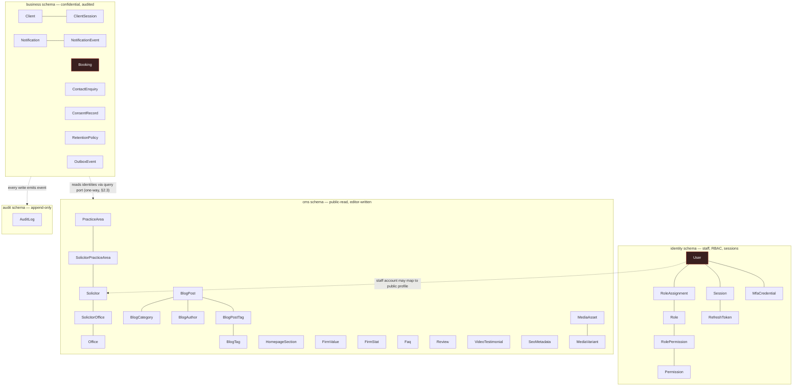
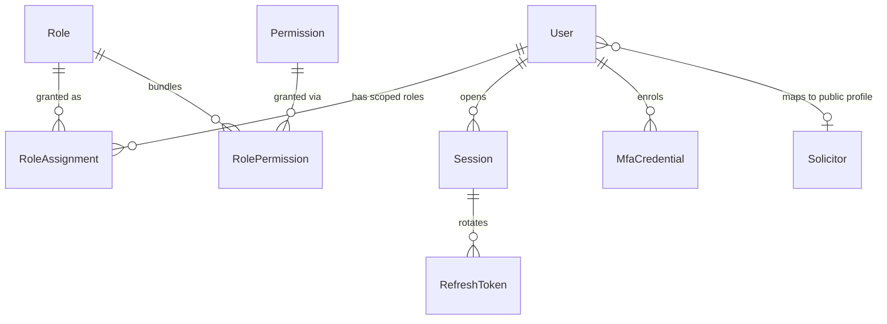
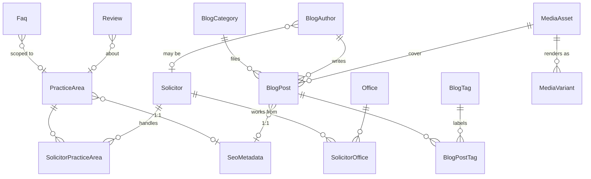

# Database Design — ALLS Solicitors

Design document. **No Prisma schema is generated here** — this defines tables, columns, keys, relationships, indexes, and growth/partitioning strategy. It is the input to a later `schema.prisma`.

It builds directly on [`ARCHITECTURE.md`](./ARCHITECTURE.md) (§0, §5, §6) and reconciles the existing forward-compat schema at [`frontend/prisma/schema.prisma`](../frontend/prisma/schema.prisma) with the brief's stricter requirements (UUID PKs, soft delete, full audit).

---

## 0. Conventions (apply to every table unless stated)

| Convention | Decision | Why |
|---|---|---|
| **Primary key** | `id uuid` — **UUIDv7**, app-generated | Brief mandates UUID. v7 is time-sortable → index locality on inserts (v4's random scatter fragments B-trees); still unguessable, unlike serial ints. ARCHITECTURE §6 already chose v7. |
| **Timestamps** | `createdAt timestamptz` (`now()`), `updatedAt timestamptz` (`@updatedAt`) | Always UTC. Never `timestamp` (no zone) — multi-office/timezone correctness depends on it. |
| **Soft delete** | `deletedAt timestamptz?` on business + CMS entities | GDPR erasure is gated by legal retention (§6), so deletes are logical first. **Excluded** from: pure join tables, append-only logs (`AuditLog`), and rotating-credential tables where hard delete + prune is correct. |
| **Slugs / emails** | `citext`, `@unique` | Case-insensitive lookups without `lower()` gymnastics; slugs stay stable public URL keys even though PK is now a UUID. |
| **Postgres schemas** | `identity`, `business`, `cms`, `audit` (Prisma `multiSchema`) | Mirrors the bounded-context split (§2). `audit` schema gets a DB role with **no UPDATE/DELETE grant** (§6) — enforced by the database, not code. |
| **Money / JSON** | none yet; `jsonb` for structured content (blog body, working hours, JSON-LD) | GIN-indexable where queried. |
| **Enums** | Postgres native enums | Cheaper than lookup tables for closed, rarely-changing sets. |

### The one deviation from the existing schema, stated up front

The forward-compat schema uses **natural-key PKs** (`Service.slug`, `Solicitor.slug`, `Office.id` as strings) and the booking `EXCLUDE` constraint keys on `solicitorSlug`. The brief overrides this: **every table gets a surrogate `uuid` PK**, and `slug` becomes a `@unique` natural key alongside it.

Consequence: **the `EXCLUDE` constraint keys on `solicitorId` (UUID), not `solicitorSlug`.** Bookings hold `solicitorId`/`practiceAreaId`/`officeId` FKs. This is the only field-for-field departure from "move it, don't rewrite it," and it's forced by the UUID requirement — flagged so the migration author expects it.

---

## 1. Schema map



The dashed edges are the **one-way valve** (ARCHITECTURE §2.3): Business may reference CMS identities (a booking needs a solicitor), CMS may **never** reference Business. Every Business write emits a domain event that Audit and Notifications subscribe to — they are not called directly.

---

## 2. `identity` schema — Authentication & RBAC

### 2.1 Tables

**`User`** — staff only (solicitors, admins, editors). Distinct from `Client` by design (§2.3 — different threat model, different auth).

| Column | Type | Notes |
|---|---|---|
| `id` | uuid PK | |
| `email` | citext `@unique` | login identifier |
| `passwordHash` | text | **Argon2id** (§4.2) |
| `fullName` | text | |
| `status` | enum `UserStatus` | `INVITED · ACTIVE · SUSPENDED · DISABLED` |
| `mfaEnrolledAt` | timestamptz? | MFA is mandatory (§4.2); null = not yet enrolled → forced on first login |
| `solicitorId` | uuid? FK → `cms.Solicitor` `@unique` | optional link staff ↔ public profile |
| `lastLoginAt`, `passwordChangedAt` | timestamptz? | |
| `createdAt`/`updatedAt`/`deletedAt` | | |

> Failed-login counters and lockout live in **Redis** (§4.2), not here — they're hot, ephemeral, and per-window. The DB stores durable identity only.

**`Role`** — `id`, `key citext @unique` (`SUPER_ADMIN · FIRM_ADMIN · SOLICITOR · PARALEGAL · RECEPTIONIST · EDITOR · CLIENT`), `name`, `description`, `isSystem bool` (protects built-ins from deletion), timestamps.

**`Permission`** — `id`, `key citext @unique` (e.g. `matter:read`, `document:download`, `content:publish`, `audit:read`), `resource`, `action`, `description`. Guards check **permissions, not roles** (§5).

**`RolePermission`** (join) — `roleId` + `permissionId`, `@@id([roleId, permissionId])`, both FKs `onDelete: Cascade`. No timestamps beyond `createdAt`.

**`RoleAssignment`** — user ↔ role **with scope**. This is where §5's `(role, scope)` model lives.

| Column | Type | Notes |
|---|---|---|
| `id` | uuid PK | |
| `userId` | uuid FK → `User` | |
| `roleId` | uuid FK → `Role` | |
| `scopeType` | enum | `GLOBAL · OFFICE · MATTER` |
| `scopeId` | uuid? | null when `GLOBAL`; else office/matter id |
| `grantedById` | uuid? FK → `User` | who granted it (audit) |
| `expiresAt` | timestamptz? | temporary elevation |
| | | `@@unique([userId, roleId, scopeType, scopeId])`, `@@index([userId])` |

**`Session`** — durable staff session; `id` **is the `sid`** referenced by JWTs and the Redis revocation denylist (§4).

`id`, `userId` FK, `createdAt`, `lastSeenAt`, `expiresAt`, `revokedAt?`, `revokedReason?`, `ipAddress inet`, `userAgent`. Indexes: `@@index([userId])`, `@@index([expiresAt])` (prune job).

**`RefreshToken`** — opaque, **hashed at rest**, rotating, with reuse detection (§4).

| Column | Type | Notes |
|---|---|---|
| `id` | uuid PK | |
| `sessionId` | uuid FK → `Session` | |
| `userId` | uuid FK → `User` | denormalized → revoke-all-for-user in one query |
| `tokenHash` | text `@unique` | SHA-256; never plaintext |
| `familyId` | uuid | rotation family — reuse of a consumed token revokes the whole family |
| `parentId` | uuid? | previous token in the chain |
| `consumedAt` | timestamptz? | set on rotation; a second presentation = theft signal |
| `expiresAt`, `revokedAt`, `revokedReason` | | |
| | | `@@index([familyId])`, `@@index([sessionId])`, `@@index([expiresAt])` |

**`MfaCredential`** — `id`, `userId` FK, `type` enum (`TOTP · RECOVERY_CODE · WEBAUTHN`), `secretEncrypted` (envelope-encrypted, §6), `confirmedAt?`, `lastUsedAt?`, `createdAt`. `@@index([userId])`.

### 2.2 Diagram & rationale



| Relationship | Why it exists |
|---|---|
| `User → RoleAssignment → Role` (M:N w/ scope) | A user has many roles; a role many users. The join carries **scope** so "SOLICITOR **on matters they're assigned**" is expressible — a plain M:N can't say *where* a role applies (§5). |
| `Role → RolePermission → Permission` (M:N) | Guards resolve a user's permissions by union over their roles. Adding a role never touches guard code (§5's whole point). |
| `User → Session → RefreshToken` (1:N:N) | One user, many devices/sessions; each session rotates through a chain of refresh tokens. Separating `Session` from `RefreshToken` is what makes **family reuse-detection** and **per-session revocation** possible. |
| `User → MfaCredential` (1:N) | One TOTP + several recovery codes per user. |
| `User ⇄ Solicitor` (0..1:1) | A staff login optionally maps to a public CMS profile; not every staff member is a public solicitor, and not every profiled solicitor logs in. Nullable both ways. This is the **only** identity→CMS reference and it points *into* CMS, respecting the valve. |

---

## 3. `business` schema — Clients, Appointments, Enquiries, Notifications

### 3.1 Client (portal) — deliberately separate from `User`

**`Client`** — `id`, `email citext @unique`, `passwordHash text?` (null = magic-link-only; §4.3), `fullName`, `phone`, `status` enum (`PROSPECT · ACTIVE · INACTIVE`), timestamps + `deletedAt`.

**`ClientMagicLinkToken`** — `id`, `clientId` FK, `tokenHash @unique` (SHA-256), `purpose` enum (`LOGIN · EMAIL_VERIFY`), `expiresAt`, `consumedAt?`, `createdAt`. `@@index([clientId])`.

**`ClientSession`** / **`ClientRefreshToken`** — structurally identical to the staff `Session`/`RefreshToken` pair but a **separate table** (isolation of blast radius, different lifecycle). Not re-listed.

> **Why not one polymorphic `Principal` table for staff + clients?** Different auth (mandatory MFA vs magic-link), different data sensitivity, different retention, different breach reporting. Merging them couples two threat models and invites a query that accidentally spans both. The duplication is the cheaper cost.

### 3.2 Booking (the "Appointments" capability)

Keeps the domain's field names (`slotStartUtc`, `displayTimeZone`, `manageToken`), with the security corrections from ARCHITECTURE's appendix baked in.

| Column | Type | Notes |
|---|---|---|
| `id` | uuid PK | |
| `reference` | citext `@unique` | human-friendly `ALLS-xxxxxx` for support/email — never exposes the UUID |
| `manageTokenHash` | text `@unique` | **SHA-256 of the manage token** (appendix #3 — was plaintext). Deterministic → still indexable for O(1) lookup |
| `manageTokenExpiresAt` | timestamptz | capability expires at appointment end + cancellation window (§4.1) |
| `status` | enum `BookingStatus` | `CONFIRMED · CANCELLED · COMPLETED · NO_SHOW` (extends the original two) |
| `practiceAreaId` | uuid FK → `cms.PracticeArea` | |
| `solicitorId` | uuid FK → `cms.Solicitor` | |
| `officeId` | uuid FK → `cms.Office` | |
| `clientId` | uuid? FK → `Client` | null for anonymous public bookings; set once a portal account exists |
| `slotStartUtc`, `slotEndUtc` | timestamptz | |
| `displayTimeZone` | text | IANA zone the client saw |
| `clientName`, `clientEmail`, `clientPhone` | text / citext | inline contact — a public booking has no `Client` row yet |
| `clientNotes` | text | **envelope-encrypted** (AES-GCM, KMS DEK) — §6 free-text may hold special-category data |
| `reminderSentAt` | timestamptz? | claim-before-send (appendix #4) |
| `cancelledAt`, `cancelReason` | | |
| `rescheduledFromStart/End` | timestamptz? | lightweight single-reschedule trail (full history → `AuditLog`) |
| `createdAt`/`updatedAt`/`deletedAt` | | |

**Constraints & indexes:**

```sql
-- Raw-SQL migration (Prisma can't express EXCLUDE). btree_gist required.
-- Partial on CONFIRMED so a cancelled booking frees its slot (appendix #2).
ALTER TABLE business."Booking" ADD CONSTRAINT booking_no_overlap
  EXCLUDE USING gist (
    "solicitorId" WITH =,
    tstzrange("slotStartUtc", "slotEndUtc") WITH &&
  ) WHERE (status = 'CONFIRMED');
```

- `@@index([solicitorId, slotStartUtc])` — availability computation, the hot read path (§18).
- `@@index([slotStartUtc])` — date-range scans, reporting, future partition key.
- Partial `@@index([reminderSentAt])` `WHERE reminderSentAt IS NULL AND status = 'CONFIRMED'` — the "due for reminder" scan touches only unsent, active rows.
- `@@index([clientEmail])` and `@@index([clientId])` — "my bookings" lookups.
- `@@index([status])`.

### 3.3 ContactEnquiry

`id`, `name`, `email citext`, `phone?`, `subject?`, `message text`, `practiceAreaId?` FK (which area), `source` enum (`CONTACT_FORM · PHONE · REFERRAL`), `status` enum (`NEW · IN_PROGRESS · RESPONDED · CLOSED · SPAM`), `assignedToId?` FK → `User`, `spamScore`, `spamReason`, `ipAddress inet`, `userAgent`, `respondedAt?`, timestamps + `deletedAt`.

Indexes: `@@index([status])`, `@@index([createdAt])`, `@@index([email])`, `@@index([assignedToId])`.

> `ipAddress`/`userAgent` are PII with a **short retention** (spam analysis only). A marketing enquiry from a non-client is exactly the data GDPR erasure *does* apply to (§6) — governed by `RetentionPolicy`.

### 3.4 Notifications

**`NotificationTemplate`** — `id`, `key citext @unique` (`booking.confirmation`, `booking.reminder`, …), `channel` enum (`EMAIL · SMS`), `category` enum (`TRANSACTIONAL · MARKETING`), `locale`, `subject?`, `bodyTemplate?`, timestamps. (Composition still happens in `emailComposer.ts`, §9; this table exists for future editor-managed templates and to pin the transactional/marketing category to a key.)

**`Notification`** — one record per message dispatched.

| Column | Type | Notes |
|---|---|---|
| `id` | uuid PK | |
| `channel` | enum `EMAIL · SMS` | |
| `category` | enum `TRANSACTIONAL · MARKETING` | drives the consent gate (§9) — **never conflate** |
| `templateKey` | citext | |
| `recipientEmail` / `recipientPhone` | citext / text | denormalized snapshot (recipient may later erase) |
| `clientId` | uuid? FK → `Client` | |
| `userId` | uuid? FK → `User` | staff notifications |
| `bookingId` | uuid? FK → `Booking` | typed relation, not polymorphic |
| `enquiryId` | uuid? FK → `ContactEnquiry` | |
| `status` | enum | `PENDING · SENT · DELIVERED · BOUNCED · FAILED · COMPLAINED` |
| `providerMessageId` | text? | correlate provider webhooks |
| `subject`, `sentAt`, `deliveredAt`, `failedAt`, `error` | | |
| `createdAt`/`updatedAt` | | no `deletedAt` — pruned by retention, not soft-deleted |

Indexes: `@@index([status])`, `@@index([clientId])`, `@@index([bookingId])`, `@@index([createdAt])`, `@@index([providerMessageId])`.

**`NotificationEvent`** — append-only provider webhook stream (delivered/opened/bounced/complained). `id`, `notificationId` FK, `type`, `payload jsonb`, `occurredAt`, `createdAt`. `@@index([notificationId])`. This is the "did the client actually get it?" evidence (§9).

**`ConsentRecord`** — PECR/GDPR consent **ledger** (append-only; each change is a new row — proof of consent with timestamp/source).

`id`, `subjectEmail citext`, `clientId?` FK, `channel` enum (`EMAIL · SMS`), `purpose` enum (`MARKETING_NEWSLETTER · MARKETING_UPDATES`), `consentGiven bool`, `source` (where captured), `ipAddress inet`, `capturedAt`, `withdrawnAt?`, `createdAt`. `@@index([subjectEmail, channel, purpose])`.

> Only **marketing** consent is stored — transactional messages ride contract/legitimate-interest and need no consent (§9). Separate `purpose` values because the compliance answer differs per stream; a single `emailOptIn` boolean is how firms become ICO-reportable.

### 3.5 Cross-cutting Business tables

**`OutboxEvent`** — transactional outbox (§8). `id`, `aggregateType`, `aggregateId`, `eventType`, `payload jsonb`, `occurredAt`, `processedAt?`, `attempts int`, `status` enum (`PENDING · PROCESSED · FAILED`). Written **in the same transaction** as the business change; a relay polls `WHERE status='PENDING'` and enqueues. `@@index([status, occurredAt])`. High churn → **deleted after processing**, not retained.

**`RetentionPolicy`** — the policy table §6 insists on instead of a "delete everything" button. `id`, `entityType` enum, `retentionPeriod interval`, `legalBasis`, `dispositionAction` enum (`SOFT_DELETE · ANONYMIZE · HARD_DELETE`), `isActive`, timestamps. A disposal job reads this; retention duty (matter files 6–15 yrs) vs erasure right (marketing enquiry) is data, not code.

> **Idempotency keys are *not* a table** — they live in Redis with 24h TTL (§3 of ARCHITECTURE). Listed here only to say explicitly: don't add a Postgres table for them.

---

## 4. `cms` schema — Catalog, Content, FAQ, Reviews, SEO, Media

### 4.1 Catalog (practice areas, solicitors, offices)

**`PracticeArea`** *(the existing `Service` model, renamed to the brief's term)* — `id`, `slug citext @unique`, `title`, `summary`, `description text`, `iconPath?`/`heroImageId?` FK → `MediaAsset`, `durationMinutes int` (booking default), `displayOrder int`, `isPublished bool`, `publishedAt?`, `seoId uuid? @unique` FK → `SeoMetadata`, timestamps + `deletedAt`. Indexes: `@@index([displayOrder])`, `@@index([isPublished])`.

**`Solicitor`** — `id`, `slug citext @unique`, `name`, `role`, `imageId?` FK → `MediaAsset`, `bio text`, `qualifications text[]`, `memberships text[]`, `languages text[]`, `experienceYears int`, `email citext`, `workingHours jsonb` (booking scheduling — the domain's `WorkingHours` shape), `displayOrder`, `isPublished`, `publishedAt?`, `seoId?` FK, timestamps + `deletedAt`.

> **Arrays vs. normalized child tables:** `qualifications`/`memberships` are display-only, never filtered → `text[]` is correct (a join table buys nothing). `languages` *could* be normalized **if** "find a solicitor who speaks X" becomes a feature — deferred, flagged.

**`Office`** — normalized address (structured data / `LocalBusiness` JSON-LD needs the parts): `id`, `slug citext @unique`, `name`, `addressLine1`, `addressLine2?`, `city`, `postcode`, `country`, `timeZone`, `latitude?`, `longitude?`, `phone?`, `email?`, `openingHours jsonb`, `displayOrder`, `isPublished`, `seoId?` FK, timestamps + `deletedAt`. This is the brief's **Office Locations**.

**`SolicitorPracticeArea`** (M:N join) — `solicitorId` + `practiceAreaId`, `@@id([solicitorId, practiceAreaId])`, cascade.
**`SolicitorOffice`** (M:N join) — `solicitorId` + `officeId`, `@@id([solicitorId, officeId])`, cascade.

### 4.2 Content (blog + homepage)

**`BlogAuthor`** — `id`, `slug citext @unique`, `name`, `role`, `imageId?` FK, `bio`, `solicitorId?` FK → `Solicitor` (some authors are solicitors; the frontend keys bylines off solicitor slugs), timestamps + `deletedAt`.

**`BlogCategory`** — `id`, `slug citext @unique`, `name`, `description`, `displayOrder`, `seoId?` FK, timestamps + `deletedAt`.

**`BlogTag`** — `id`, `slug citext @unique`, `name`, `createdAt`.

**`BlogPost`** — `id`, `slug citext @unique`, `title`, `excerpt`, `coverImageId?` FK → `MediaAsset`, `categoryId` FK → `BlogCategory`, `authorId` FK → `BlogAuthor`, `body jsonb` (structured blocks — the domain's `body[]`), `status` enum (`DRAFT · SCHEDULED · PUBLISHED · ARCHIVED`), `publishedAt timestamptz?` (future = scheduled), `readingTimeMinutes int?` (cached; computed at publish), `seoId?` FK, timestamps + `deletedAt`. Indexes: `@@index([status, publishedAt])`, `@@index([categoryId])`, `@@index([authorId])`.

**`BlogPostTag`** (M:N join) — `postId` + `tagId`, `@@id([postId, tagId])`, cascade.

**`HomepageSection`** — editor-managed homepage blocks. `id`, `key`/`type` enum (`HERO · STATS · VALUES · FEATURED_REVIEWS · CTA · SERVICES · ABOUT`), `title?`, `subtitle?`, `content jsonb` (flexible per block), `displayOrder`, `isPublished`, timestamps + `deletedAt`.

**`FirmValue`** — `id`, `title`, `description`, `iconPath?`, `displayOrder`, `isPublished`, timestamps + `deletedAt`.
**`FirmStat`** — `id`, `label`, `value`, `suffix?`, `displayOrder`, `isPublished`, timestamps + `deletedAt`.

> Values/Stats are modeled as **normalized child tables** rather than buried in `HomepageSection.content` jsonb, because editors CRUD them individually and they render as ordered lists. If they were only ever an opaque blob, jsonb would win — they're not.

### 4.3 FAQ

**`Faq`** — `id`, `question`, `answer text` (rich), `practiceAreaId?` FK (scoped to an area, or general when null), `displayOrder`, `isPublished`, `seoId?` FK, timestamps + `deletedAt`. Indexes: `@@index([practiceAreaId])`, `@@index([displayOrder])`, `@@index([isPublished])`.

### 4.4 Reviews

**`Review`** (extends the existing model with a moderation queue for future client submission, §2.2). `id`, `authorName`, `authorImage?`, `rating int` (CHECK `1..5`), `title?`, `body text`, `practiceAreaId?` FK (was `serviceSlug`), `source` enum (`SITE · GOOGLE`), `reviewDate timestamptz`, `verified bool`, `helpfulCount int`, `featured bool` (editorial), `status` enum (`PENDING · APPROVED · REJECTED`), `clientId?` FK (future submission), timestamps + `deletedAt`. Indexes: `@@index([source])`, `@@index([rating])`, `@@index([featured])`, `@@index([status])`, `@@index([practiceAreaId])`.

**`VideoTestimonial`** — `id`, `authorName`, `role`, `posterImageId?` FK, `videoUrl text?` (null = "coming soon" card), `caption`, `rating int`, `displayOrder`, `isPublished`, timestamps + `deletedAt`.

### 4.5 SEO Metadata

**`SeoMetadata`** — reusable metadata attached two ways: **entity-owned** (1:1 via the `seoId` FK on `PracticeArea`/`Solicitor`/`Office`/`BlogPost`/`BlogCategory`) or **route-owned** (standalone rows for static pages like `/`, `/about`, keyed by `routePath`).

| Column | Type | Notes |
|---|---|---|
| `id` | uuid PK | |
| `routePath` | citext? `@unique` | set only for standalone static-route rows; null when entity-owned |
| `title`, `description` | text | |
| `canonicalUrl` | text? | |
| `ogTitle`, `ogDescription` | text? | |
| `ogImageId` | uuid? FK → `MediaAsset` | |
| `twitterCard` | text? | |
| `robots` | text? | `index,follow` / `noindex` |
| `keywords` | text[] | |
| `jsonLd` | jsonb? | editor override for structured data (frontend still *emits* it — §0 of ARCHITECTURE keeps rendering in the frontend) |
| `createdAt`/`updatedAt` | | |

> **Why 1:1 FK for entities + `routePath` for static routes**, rather than a polymorphic `(ownerType, ownerId)`: polymorphic ownership can't have a real DB foreign key, so it silently rots when an owner is deleted. The `seoId` FK gets referential integrity and cascade for free; static routes have no owning row, so they carry their own unique `routePath`. One table, two clean attachment modes, no orphans.

### 4.6 Media Library

**`MediaAsset`** — **public assets only** (§2.2 — the confidential document store is a future *Business* module, never this one). `id`, `storageKey text @unique` (S3 key — never a user-supplied filename, §7), `bucket`, `filename` (original, for `Content-Disposition`), `mimeType`, `byteSize bigint`, `width?`, `height?`, `checksum text` (SHA-256, dedupe), `altText?`, `caption?`, `title?`, `uploadedById?` FK → `User`, timestamps + `deletedAt`. Indexes: `@@index([mimeType])`, `@@index([checksum])`.

**`MediaVariant`** — renditions. `id`, `mediaAssetId` FK, `variant` enum (`THUMBNAIL · SMALL · MEDIUM · LARGE · WEBP · AVIF`), `storageKey text @unique`, `width`, `height`, `byteSize`, `format`, `createdAt`. `@@unique([mediaAssetId, variant])`.

### 4.7 Catalog & content diagram



| Relationship | Why it exists |
|---|---|
| `Solicitor ⇄ PracticeArea` (M:N) | A solicitor practices several areas; an area has several solicitors. Drives "who can I book for X" + profile listings. |
| `Solicitor ⇄ Office` (M:N) | Multi-office support (§18) falls out of the join — a solicitor may sit in several offices; booking filters availability by office. |
| `BlogPost → BlogCategory` / `→ BlogAuthor` (N:1) | A post has exactly one category and one author byline; both are reused across posts. Separate `BlogAuthor` (not `User`) because authors are public content, not accounts. |
| `BlogPost ⇄ BlogTag` (M:N) | Tags cross categories; normalized into `BlogTag` (not a `text[]`) because tag pages are indexed URLs needing their own slug + SEO. |
| `BlogAuthor ⇄ Solicitor` (0..1) | Three of the authors are also solicitors; the link avoids duplicating name/photo while allowing non-solicitor guest authors. |
| `Faq / Review → PracticeArea` (N:0..1) | Both optionally scope to an area (area-specific FAQ block, per-service review filtering) or stay general (null). |
| `entity → SeoMetadata` (1:1) | Per-route metadata the brief requires; 1:1 so each page owns its overrides with FK integrity (§4.5). |
| `MediaAsset → MediaVariant` (1:N) | One upload, many renditions (responsive images). Variants are derived, so no `deletedAt` — they die with the parent. |

---

## 5. `audit` schema — append-only

**`AuditLog`** — the regulatory record (§10). **No `updatedAt`, no `deletedAt`** — immutable by construction, and the app DB role holds **no UPDATE/DELETE grant** on this schema (§6). An audit log the app can rewrite isn't evidence.

| Column | Type | Notes |
|---|---|---|
| `id` | uuid PK | UUIDv7 → time-ordered |
| `actorType` | enum | `STAFF · CLIENT · SYSTEM · ANONYMOUS` |
| `actorId` | uuid? | |
| `actorLabel` | text? | email snapshot at the time (actor may later be deleted) |
| `action` | text | `booking.cancelled`, `matter.read`, `content.published`, `auth.login.failed` |
| `resourceType`, `resourceId` | text / uuid? | |
| `outcome` | enum | `SUCCESS · FAILURE · DENIED` |
| `ipAddress` | inet? | |
| `userAgent` | text? | |
| `context` | jsonb? | before/after diff, request metadata, `traceId` |
| `occurredAt` | timestamptz | **partition key** |
| `createdAt` | timestamptz | |

Indexes: `@@index([resourceType, resourceId])` ("who touched this file"), `@@index([actorId])`, `@@index([action])`, plus a **BRIN** index on `occurredAt` (see §7). Audited events include **reads** of matters/documents (§10) — unusual, but "who viewed this file, and when" is precisely the regulated question.

---

## 6. Indexing strategy (summary)

Principles applied throughout:

- **Every FK is indexed.** Postgres does not auto-index the referencing side; unindexed FKs make joins and cascade-deletes table-scan.
- **Partial indexes for skewed predicates.** The reminder scan (`WHERE reminderSentAt IS NULL AND status='CONFIRMED'`), published-content filters (`WHERE isPublished`), and the booking `EXCLUDE` (`WHERE status='CONFIRMED'`) index only the rows actually queried — smaller, hotter, cache-friendly.
- **Composite order matches access.** `(solicitorId, slotStartUtc)` serves both "this solicitor's day" and "this solicitor's bookings" (leftmost-prefix); the reverse order wouldn't.
- **`citext @unique` on every slug/email** — case-insensitive uniqueness + lookup without functional indexes.
- **GIN on queried `jsonb`** only (e.g. if `Booking`/audit `context` is ever filtered) — not by default; GIN is expensive to maintain.
- **BRIN on append-only time columns** (`AuditLog.occurredAt`, `NotificationEvent.occurredAt`) — a BRIN index is a few KB vs. a multi-GB B-tree and is ideal for physically-ordered, insert-only, range-scanned data.
- **Materialized view for `Review` stats** (avg rating, counts per practice area) — refreshed on write; keeps the homepage aggregate off a full scan.

---

## 7. Growth analysis & partitioning

For **one UK firm**, the system is **not traffic-bound** (§18) — the binding constraints are correctness and compliance. Row growth, ordered:

| Table | Growth driver | ~Scale (one firm) | Verdict |
|---|---|---|---|
| **`AuditLog`** | every auth event + every business write + every **read** of a matter/document | **Highest — unbounded, monotonic** | **Partition.** |
| **`NotificationEvent`** | provider webhook per message × multiple events each | High | **Partition** (or archive+prune). |
| **`Notification`** | one per email/SMS | Moderate–high | Prune by retention; partition only if it outgrows cache. |
| **`OutboxEvent`** | one per domain event | High churn, **self-pruning** | **Delete after processed** — never let it accumulate. Not partitioned. |
| **`Session` / `RefreshToken`** (× client variants) | login/rotation churn | Moderate, self-limiting | Scheduled prune of `expiresAt < now()`. |
| **`Booking`** | appointments | **Low** — low thousands/yr | Index well; **do not** partition yet. |
| **`ContactEnquiry`** | form + spam | Low–moderate | Prune `SPAM`; retention on non-clients. |
| **CMS tables** (posts, areas, solicitors, reviews, media…) | editor actions | **Small** | No partitioning ever needed. |

### Partitioning recommendations

**`AuditLog` — range-partition by `occurredAt`, monthly.** This is the one table where it clearly pays:
- Retention is time-based (years per `RetentionPolicy`) → disposing of an expired period is a `DETACH PARTITION` + drop, **not** a giant `DELETE` that bloats and vacuums.
- All queries are time-bounded ("activity on resource X in Q2") → **partition pruning** scans only relevant months.
- Append-only + physically time-ordered → **BRIN** on `occurredAt` within each partition is tiny and effective.
- Automate partition creation/rotation with **`pg_partman`** (pre-create ahead, detach+archive+drop behind).

**`NotificationEvent` — same pattern, monthly by `occurredAt`,** if volume justifies it; otherwise a simpler archive-and-prune job. Decide from real numbers, not upfront.

**Everything else: don't.** Partitioning `Booking` or CMS tables at this scale adds planning overhead and operational surface for tables that fit comfortably in RAM. Partition when a table crosses ~tens of millions of rows or when time-based disposal makes `DETACH` worth it — only `AuditLog` (and maybe `NotificationEvent`) meet that bar here.

### Other optimizations

- **PgBouncer (transaction mode)** in front of RDS (§6) — pooling stability.
- **Read replica** for analytics/reporting so heavy aggregate scans stay off the write path (§18).
- **Redis cache for the availability hot path** — cache per `(solicitorId, day)`, invalidate on booking write (§18). The DB stays the source of truth; the cache absorbs the read volume.
- **Envelope-encrypt** `clientNotes`, `MfaCredential.secret`, and future matter/document fields (AES-GCM, KMS-managed DEK) — disk encryption alone doesn't cover SQLi, a leaked replica, or a stolen backup (§6).
- **`pg_repack`** for periodic bloat control on high-churn tables (`Session`, `OutboxEvent`, `Notification`).

---

## 8. Open items (carried from ARCHITECTURE §"Open questions")

These change the schema and are the firm's to answer, not engineering's:

1. **Retention periods per matter type** (COLP) → seeds `RetentionPolicy` rows and the disposal job's behavior.
2. **Data residency** (UK-only vs EU) → doesn't change columns, changes where this DB lives (§17).
3. **Client-money model** (COFA) → the future `payments` schema (out of scope now); SRA Accounts Rules make it a compliance design, not a Stripe integration.
4. **Special-category field inventory** → confirms exactly which columns get application-level envelope encryption beyond `clientNotes`.

Not modeled yet, by design (future Business modules — §18): `matters`, `documents`, `payments`. Their tables slot into the `business` schema behind the same conventions; the `RoleAssignment.scopeType = MATTER` hook and the one-way valve already anticipate them.
