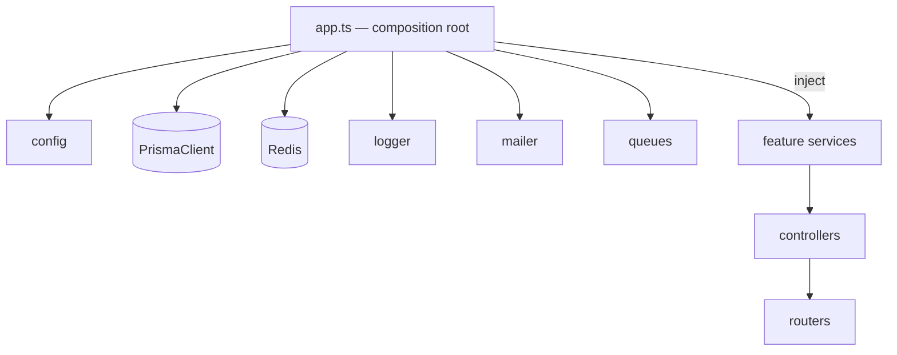

# Infrastructure Layer Design — ALLS Solicitors

Design document. **No implementation.** Defines the cross-cutting infrastructure — the shared clients, platform services, and their wiring — that every feature module consumes but none owns.

Builds on [`FOLDER-STRUCTURE.md`](./FOLDER-STRUCTURE.md) (the `config/`, `db/`, `queues/`, `docs/`, `middleware/`, `shared/` folders), [`ARCHITECTURE.md`](./ARCHITECTURE.md) §6–§10, §14–§15, and the Redis/queue usage in [`AUTH-DESIGN.md`](./AUTH-DESIGN.md) and [`RBAC-DESIGN.md`](./RBAC-DESIGN.md). Stack: **Express + TypeScript** (per FOLDER-STRUCTURE).

> **On "dependency injection / singletons / module boundaries."** Express has no built-in DI container (unlike NestJS). This document specifies the **lightweight, explicit pattern** that gives the same guarantees without the framework: a **composition root** that constructs singletons once and injects them. That's the deliberate "avoid enterprise complexity" choice from the folder-structure brief — §2–§4 explain it.

---

## 1. What "infrastructure" means here

Everything that talks to the outside world or is shared process-wide: the database client, Redis, the queue system, mail transport, the logger, config, health, and docs. Feature modules (`modules/*`) contain **business logic**; the infrastructure layer contains the **plumbing they plug into**. The dividing line: infrastructure knows nothing about bookings or blog posts; features know nothing about connection pooling.

```
src/
├── config/     env validation + typed config          ← §5
├── db/         Prisma + Redis singletons               ← §6, §7
├── queues/     BullMQ connection, queues, processors   ← §10
├── shared/     logger, mailer port, cache, errors      ← §8, §9, §11
├── middleware/ rate limiter, health wiring             ← §12, §13
├── docs/       OpenAPI/Swagger assembly                ← §14
├── app.ts      the composition root (§2)
├── server.ts   API entrypoint
└── worker.ts   worker entrypoint (§10)
```

---

## 2. Dependency injection — the composition root

**The pattern: manual (explicit) DI via a composition root.** One place constructs every singleton and passes it into the things that need it. No decorators, no reflection, no container library.

- **Infrastructure clients** (Prisma, Redis, logger, mailer, queues) are instantiated **once** in the composition root at boot.
- **Feature services** receive their dependencies as **constructor arguments** (or factory-function parameters): `createBookingService({ prisma, mailer, clock, logger })`. A service never reaches out and imports a global — it's *given* what it needs.
- **`routes/v1.ts` + `app.ts` are the composition root** — the only place allowed to know both a concrete client and a feature service, and to wire them together. (This is exactly the role `container.ts` played in the original frontend, and the role a NestJS module's `providers` array plays — just written by hand.)



**Why manual DI over a container library:**
- **It's explicit** — you can read the wiring; nothing is resolved by magic string or type at runtime.
- **It's trivially testable** — a unit test calls `createBookingService({ prisma: fakePrisma, mailer: fakeMailer, clock: fixedClock })`. No test harness, no container bootstrapping. The dev adapters from the original codebase (`InMemory*`, `Console*`) become the fakes verbatim (ARCHITECTURE §16).
- **It matches the brief** — a DI framework is the "enterprise complexity" the folder-structure brief said to avoid. For fifteen modules and two entrypoints, a composition root is enough.

**The one rule:** dependencies are **passed in, never imported at module scope** inside a service. Importing the Prisma singleton directly into `booking.service.ts` works, but it welds the service to that client and defeats the fake-in-a-test property. Inject it.

---

## 3. Singleton services

Some things must exist **exactly once per process** — because they hold a connection pool, a socket, or expensive-to-build state. Creating them per-request or per-feature exhausts connections and leaks memory.

| Singleton | Why one instance | Consequence of getting it wrong |
|---|---|---|
| **`PrismaClient`** | owns the Postgres connection pool | N clients = N pools = connection exhaustion on RDS |
| **Redis (general)** | one multiplexed command connection | reconnection storms, wasted sockets |
| **Redis (BullMQ)** | BullMQ needs its **own** connections (blocking ops) | sharing the general client breaks both |
| **`logger` (pino)** | one configured root; features use child loggers | inconsistent formatting, lost correlation |
| **`mailer`** | one configured transport (pooled SMTP / Resend client) | connection churn |
| **queue instances** | one `Queue` per name (producer side) | duplicate schedulers, race on repeatables |
| **`config`** | validated once at boot, immutable thereafter | re-parsing env, drift |

**How "singleton" is enforced without a DI container:** they're constructed **once in the composition root** and injected. There is no `new PrismaClient()` scattered across the codebase — the `db/` module exports a single constructed instance (a module-level constant, which Node caches on first import), and the composition root hands it out. Node's module cache guarantees the module body runs once; the composition-root discipline guarantees nobody constructs a second one.

**Stateless domain services** (e.g. availability calculation) can *also* be singletons — they hold no per-request state, so one instance serves all requests. Anything holding request state is created per-request instead (the request-scoped principal, the correlation id — §9).

---

## 4. Module boundaries

Three boundaries, enforced by convention + ESLint import rules (not a framework):

1. **Infrastructure ↛ features.** `db/`, `config/`, `shared/` must never import from `modules/*`. Plumbing can't depend on business logic, or the layering inverts. (The logger doesn't know what a booking is.)
2. **Feature ↛ feature internals.** A module may call another module's **service** (imported explicitly and injected), but **never** another module's repository or Prisma models. `booking` needing a solicitor calls `solicitorsService.findBySlug()`, never `prisma.solicitor.findMany()`. This is the one-way-valve discipline (ARCHITECTURE §2.3) expressed in an Express codebase — it's what keeps a future module-split cheap.
3. **Features → infrastructure, only through what they're given.** Features depend on the *injected* client/port, not on reaching into `db/` themselves (§2's rule).

Where **swappability** is real (mail provider, object storage), the boundary is a **narrow port** — a small interface the feature depends on, with the concrete adapter chosen in the composition root (§8). Where it isn't (Prisma is the database access, full stop), there's no port — an interface hiding a single permanent implementation is the ceremony the brief rejects. **Ports where they buy a swap; direct dependency where they don't.**

---

## 5. Configuration & environment validation

**One typed config object, validated at boot, immutable.** (`config/`)

- **Validation:** a Zod schema parses `process.env` **once at startup**. A missing or malformed variable **crashes the process loudly** — it never starts degraded. This directly kills the fail-open class of bug (ARCHITECTURE §14: a missing `CRON_SECRET` making an endpoint public; a missing `RESEND_API_KEY` silently dropping every email). **Fail closed, fail loud, fail at deploy.**
- **Typed access:** everything reads `config.database.url`, `config.redis.url`, `config.jwt.privateKey`, etc. — **no bare `process.env` reads** anywhere outside `config/`. The rest of the app can't even see raw env.
- **Grouped by concern:** `database`, `redis`, `jwt`, `mail`, `storage`, `security`, `queues`, `app` (env name, port, `APP_ROLE`).
- **Secrets** come from AWS Secrets Manager / Vault in deployed environments, injected as env at runtime; `.env` is local-only, `.env.example` documents every variable and whether it's required (ARCHITECTURE §13–§14).

```
config: { app, database, redis, jwt, mail, storage, security, queues }   // frozen after parse
```

Config is the **first** thing the composition root builds — every other singleton depends on it.

---

## 6. Prisma (database)

- **Single `PrismaClient` singleton** (`db/`), injected everywhere (§2–§3).
- **Pooling:** **PgBouncer in transaction mode** in front of RDS (ARCHITECTURE §6). Prisma's connection URL carries `pgbouncer=true` so it doesn't rely on session-level prepared statements PgBouncer can't keep.
- **Migrations run as a separate deploy step**, never on app boot (ARCHITECTURE §15) — N replicas booting must not race N `migrate deploy`s. `worker.ts`/`server.ts` assume the schema is already migrated.
- **Client extensions** encapsulate cross-cutting DB concerns once: soft-delete default filtering (`deletedAt IS NULL`), UUIDv7 generation, and `updatedAt` handling — so features don't repeat them.
- **Transactions** are used by repositories that need them (the booking `EXCLUDE` catch, the notification outbox write — DB-design §3). The client exposes `$transaction`; the repository owns the boundary.
- **Health:** a lightweight `SELECT 1` backs the readiness probe (§13).

---

## 7. Redis

**One Redis server, multiple logical uses, two connection classes** (BullMQ can't share the general command connection — it holds blocking connections).

| Use | Connection | Detail |
|---|---|---|
| Session store + revocation allowlist (`session:{sid}`) | general | AUTH-DESIGN §4 |
| Permission cache (`perm:*`, `roleperms:*`) | general | RBAC-DESIGN §6 |
| Rate-limit / login-throttle counters | general | §13, AUTH §6.4 |
| Response/read caching | general | §8 |
| Idempotency keys (`Idempotency-Key`) | general | API-DESIGN §0.2 |
| Pub/sub for cache invalidation fan-out | general (sub needs its own) | RBAC-DESIGN §6 |
| **BullMQ** queues/workers | **dedicated** (`maxRetriesPerRequest: null`) | §10 |

The **general Redis client is a singleton**; pub/sub subscription needs a second connection (Redis can't `SUBSCRIBE` and issue commands on the same one); BullMQ manages its own. All point at the same Redis instance (ElastiCache in prod). **Nothing in Redis is a source of truth** — a cold Redis degrades (forced re-login, cache misses), it never loses data.

---

## 8. Caching

**Cache-aside over Redis**, exposed as a small `Cache` helper in `shared/` (get / set-with-TTL / delete / delete-by-pattern).

- **What's cached:** the hot public reads — catalog and content (practice areas, solicitors, homepage, published blog), the **availability computation per `(solicitorId, day)`** (the genuine hot path, ARCHITECTURE §18), review stats, and the RBAC permission sets (§7).
- **Invalidation is event-driven, not TTL-hope:** a CMS publish busts that resource's keys and triggers ISR (API-DESIGN §6.1); a booking write busts the affected availability day; an RBAC change fans out over pub/sub (RBAC §6). TTLs are a **safety net**, not the primary correctness mechanism.
- **Keys are namespaced** (`cache:availability:{solicitorId}:{day}`) so pattern-deletes are scoped.
- **Layered with the CDN:** public GETs are also CDN-cacheable (API-DESIGN §0.1); Redis is the origin-side cache behind it. Two layers, invalidated together on publish.

---

## 9. Logging

**Structured JSON via pino** (`shared/logger`), one root logger singleton, child loggers per request/module.

- **Correlation:** `X-Request-Id` (accepted or generated) is carried through **AsyncLocalStorage** into every log line *and into job payloads*, so a worker's logs link back to the request that queued them (ARCHITECTURE §10). This is the request-scoped state that is *not* a singleton.
- **Redaction is mandatory** — pino `redact` on `authorization`, `cookie`, `password`, `clientEmail`, `clientPhone`, `clientNotes`, tokens, filenames. Default to logging **IDs, not payloads**. A law firm spilling privileged content into a log platform is a reportable breach.
- **Application logs ≠ audit logs.** This logger is for debugging (30-day retention, redacted, lossy-OK, ships to Loki/Datadog). The **`AuditLog`** is the legal record (Postgres, append-only, never redacted, years) — a different system entirely (ARCHITECTURE §10, DB-design §5). They are never the same sink.
- **Errors** additionally go to Sentry (PII-scrubbed) in prod.

---

## 10. BullMQ & background workers

**Workers run in a separate process from the API — same image, different entrypoint** (`worker.ts`, `APP_ROLE=worker`). A ClamAV scan or a 500-recipient send must not compete with HTTP handling for the event loop, and the two scale on different signals (ARCHITECTURE §8, §15).

- **Queues, split by SLA/failure domain:** `email`, `sms`, `documents`, `reminders`, `cms-revalidate`, `webhooks`, `analytics` — each with its own concurrency, retry policy, and rate limiter (Resend and Twilio have different quotas). A wedged calendar-sync job mustn't delay a booking confirmation.
- **Producers** (the API) hold `Queue` singletons (§3); **processors** live in `queues/` and call into feature **services** (respecting §4 — a processor is just another caller of the business logic).
- **Reliability** (ARCHITECTURE §8): idempotent jobs with natural-key `jobId` (`reminder:{bookingId}`) for free dedupe; exponential backoff → DLQ that **alerts**; **transactional outbox** for must-not-lose effects (booking confirmation) — the outbox row commits with the booking, a relay enqueues.
- **Reminders** are a **repeatable job** (hourly), coordinated through Redis so N replicas fire it **once** cluster-wide — replacing the deleted Vercel cron — with claim-before-send (AUTH/ARCHITECTURE §8, appendix #4).
- **Graceful shutdown:** on SIGTERM the worker stops accepting new jobs and lets in-flight ones finish before exiting (§15).

---

## 11. Mail

**A narrow `Mailer` port** (`shared/`) — `send(message)` — with the transport chosen in the composition root by environment. This is a genuine swap point, so it gets a port (§4).

| Environment | Adapter |
|---|---|
| production | **Resend** (with SMTP fallback) |
| local / dev | **Mailpit** (in docker-compose) — catches mail, never sends |
| test | in-memory fake (the original `ConsoleNotificationService`) |

- **Composition** (subject/body/`.ics`) happens in the notification module's composer, not in the port — the port is deliberately just "send an email" so it's trivially swappable (ARCHITECTURE §9).
- **Non-prod recipient allowlist:** in any environment that isn't production, mail to non-allowlisted domains is dropped/redirected — the guard that stops a staging seed run from emailing 400 real clients (ARCHITECTURE §9). Cheap; the failure it prevents is unrecoverable.
- Mail is **sent from workers** via the `email` queue, never inline in a request.

---

## 12. Rate limiting

**Redis-backed** (`middleware/` + the general Redis client), so limits hold **across all API replicas** — the original in-memory limiter became `5×N` across N instances (ARCHITECTURE appendix #6).

- **Tiered:** global per-IP (coarse) + strict per-route (login 5/15min, booking create 5/15min, password reset) + per-account lockout (AUTH §6.4).
- **`Retry-After`** on every `429`.
- **Trust-proxy configured correctly** so limits key off the real client IP, not the load balancer (ARCHITECTURE §13) — otherwise the whole internet throttles as one user.

---

## 13. Health checks

Two endpoints, **deliberately not conflated** (ARCHITECTURE §15):

| Endpoint | Checks | Used by |
|---|---|---|
| `GET /health/live` | process is alive (event loop responsive) | liveness probe — restart if failing |
| `GET /health/ready` | Postgres `SELECT 1` **and** Redis `PING` reachable | readiness probe — pull from load balancer if failing |

**Why separate:** a transient DB blip should pull a pod out of rotation (readiness) but **not** kill it (liveness) — killing healthy pods during a DB incident is exactly the wrong move. Returns `200` healthy / `503` + details otherwise.

---

## 14. Swagger / OpenAPI

- **The spec is generated from the Zod schemas** in each module's `*.schema.ts` (via `zod-to-openapi`), assembled in `docs/`. One source of truth flows to validation *and* documentation — no hand-written, drifting API doc (ARCHITECTURE §3, §12).
- **Served at `/docs`** — behind admin auth in production, open in local/dev.
- **Snapshot-diffed in CI:** the generated OpenAPI doc is committed and diffed, so a breaking contract change surfaces in review rather than at runtime (ARCHITECTURE §12, §16).

---

## 15. Docker

**Multi-stage build:** `deps → build → runtime`. `node:22-slim` (or distroless) runtime; `package.json` + lockfile copied first for layer caching; `.dockerignore` everything else.

- **One image, two roles.** API and worker share the identical image, differ by `APP_ROLE=api|worker` (which entrypoint runs). Guarantees the worker runs the exact bytes CI tested, and halves the build matrix (ARCHITECTURE §15).
- **Runtime hardening:** non-root user, read-only root filesystem, dropped capabilities, no shell in the production image.
- **Migrations are a separate deploy step**, not baked into container start (§6).
- Image scanned (Trivy) in CI; base pinned by digest.

---

## 16. Docker Compose (local)

One command brings up the **same service topology as production**, so "works locally" means something (ARCHITECTURE §15):

| Service | Role |
|---|---|
| `postgres` | database |
| `redis` | cache / sessions / queues |
| `mailpit` | catches outbound mail (§11) |
| `minio` | S3-compatible object storage for local dev (§7 storage) |
| `api` | the Express app (`APP_ROLE=api`) |
| `worker` | BullMQ workers (`APP_ROLE=worker`) |
| `bull-board` *(optional)* | queue dashboard, behind admin auth |

Each has a healthcheck; `api`/`worker` `depends_on` postgres+redis being healthy. Volumes persist Postgres/Redis across restarts.

---

## 17. Lifecycle — boot & graceful shutdown

**Boot order** (composition root, both entrypoints):
```
1. parse + validate config      (crash loudly on miss — §5)
2. build logger
3. connect Prisma, connect Redis
4. construct singletons (mailer, queues, cache)
5. wire feature services (inject singletons — §2)
6a. server.ts → build Express app, listen        (API role)
6b. worker.ts → register queue processors        (worker role)
7. readiness probe flips to healthy
```

**Graceful shutdown** (SIGTERM):
```
stop accepting new work (close HTTP server / pause queue intake)
 → drain in-flight requests / let running jobs finish
 → close BullMQ workers cleanly (so a mid-send job isn't killed and retried)
 → disconnect Prisma and Redis
 → exit
```
This is what keeps a deploy from dropping in-flight bookings or double-sending a half-finished email batch (ARCHITECTURE §15).

---

## 18. How the requirements map

| Requirement | Section |
|---|---|
| Prisma | §6 |
| Redis | §7 |
| BullMQ / background workers | §10 |
| Mail | §11 |
| Logging | §9 |
| Configuration | §5 |
| Environment validation | §5 |
| Caching | §8 |
| Rate limiting | §12 |
| Health checks | §13 |
| Swagger | §14 |
| Docker | §15 |
| Docker Compose | §16 |
| Dependency injection | §2 |
| Singleton services | §3 |
| Module boundaries | §4 |
