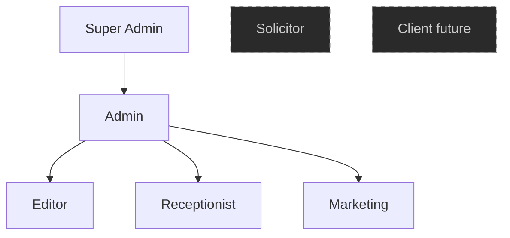
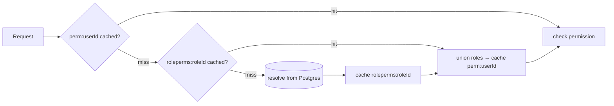
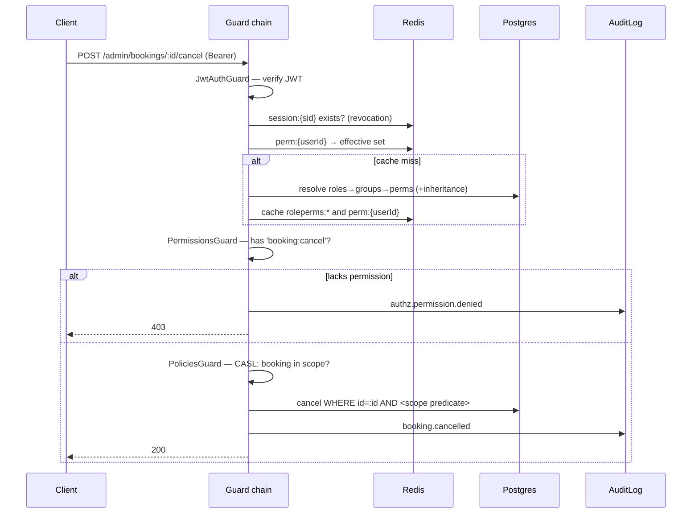

# RBAC Architecture — ALLS Solicitors

Design document. **Architecture before implementation** — this explains the model, the resolution and caching strategy, and the enforcement layer. Illustrative decorator/guard *signatures* are shown; no full implementations.

Builds on [`ARCHITECTURE.md`](./ARCHITECTURE.md) §5, the `identity` schema in [`DATABASE-DESIGN.md`](./DATABASE-DESIGN.md) §2, and [`AUTH-DESIGN.md`](./AUTH-DESIGN.md) §7 (the `perm:{userId}` cache and `authorize` middleware).

> **Stack note.** Canonical framework: **Express + TypeScript** (decided — see [`ARCHITECTURE.md`](./ARCHITECTURE.md) stack banner). The RBAC model below (§1–§7, §9–§10) is framework-agnostic and authoritative. The enforcement layer (§8) shows the **NestJS** idiom the brief named (Guards + Decorators) **alongside the authoritative Express form** (ordered middleware + route metadata) in the same tables — in this build the **Express column is the one that ships**; the NestJS column is illustrative of the same design.

---

## 1. The core decision: two authorization layers, not one

**RBAC alone is insufficient here** (ARCHITECTURE §5). "Can this user read matters?" and "can this user read *this* matter?" are different questions, and a firm holding privileged files must answer both. So authorization is **two composed layers**:

| Layer | Question | Mechanism | Failure mode it prevents |
|---|---|---|---|
| **1. RBAC (coarse)** | Does the principal hold permission `X` at all? | Permission check in a **Guard**, from a cached effective-permission set | Missing capability → `403` |
| **2. Scope (fine)** | May they exercise `X` on *this specific resource*? | **CASL** ability → conditions pushed into the Prisma `where` | **IDOR** — serving another client's file |

This document specifies **Layer 1** in depth (the RBAC engine the brief asks for) and shows where **Layer 2** plugs in. Layer 1 is a fast yes/no gate; Layer 2 turns authorization into a query predicate so a forgotten `if` can't leak a row. Neither replaces the other.

---

## 2. Roles

Seven roles. Guards **never branch on role** in business code (§8.4) — roles exist only to *bundle permissions*; code checks permissions.

| Role | Purpose | Scope model |
|---|---|---|
| **Super Admin** | Platform owner. Implicit `*:*`, manages system roles, break-glass. Cannot be locked out. | global |
| **Admin** (firm admin) | Runs the firm's operations: staff, content, bookings, settings, audit. | global (or `office:{id}` for a branch admin) |
| **Solicitor** | Practises: own bookings/availability, assigned enquiries, own matters (future). | **`matter:{id}` / self-scoped** |
| **Editor** | Owns marketing content: practice areas, blog, FAQ, homepage, offices, media — publish. | global (content only) |
| **Receptionist** | Front desk: manage bookings for all solicitors, triage enquiries, look up clients. | global (business ops) |
| **Marketing** | Blog/homepage content + publishing, media, review moderation, **marketing notifications & consent**. | global (marketing surface) |
| **Client** *(future)* | Portal self-service: own bookings, own matter/documents, submit reviews. | **`self` only** |

Reconciliation with earlier docs: `Admin` = the previously-named `FIRM_ADMIN`; `Marketing` is new; `Paralegal` is deferred (slots in as a scoped sibling of `Solicitor` when needed). `Client` is entirely separate from staff — different principal, different auth (`AUTH-DESIGN.md` §1), and **not part of the staff inheritance graph** (§4).

---

## 3. The permission model

Four building blocks, composing from finest to coarsest:

```
Permission  ──grouped into──▶  PermissionGroup  ──granted to──▶  Role  ──assigned to──▶  User
     │                                                             ▲
     └──────────────── also granted directly to ──────────────────┘
                                                        Role ──inherits──▶ Role (§4)
```

### 3.1 Permission
The atom. Key format **`resource:action`** — stable, greppable, and the same strings the Guards and CASL rules reference.

Examples: `user:read`, `user:create`, `role:update`, `booking:read`, `booking:cancel`, `enquiry:update`, `content:create`, `content:publish`, `review:moderate`, `media:delete`, `notification:send`, `settings:update`, `audit:read`. Wildcards allowed for coarse grants: `booking:*`, and `*:*` for Super Admin.

### 3.2 Permission Group
A **named bundle** of permissions — the unit humans actually reason about ("content management"), so admins assign *groups* to roles, not 40 individual permissions. Groups make the role matrix (§9) legible and keep grants consistent when a new permission is added to a capability.

| Group | Bundles |
|---|---|
| `identity-management` | `user:*`, `role:*` |
| `booking-management` | `booking:*` |
| `enquiry-management` | `enquiry:*` |
| `content-authoring` | `content:create`, `content:read`, `content:update`, `content:delete` |
| `content-publishing` | `content:publish` |
| `review-moderation` | `review:*` |
| `media-management` | `media:*` |
| `notification-management` | `notification:*` |
| `settings-management` | `settings:*` |
| `audit-access` | `audit:read` |
| `portal-self` *(future)* | `booking:read:self`, `matter:read:self`, `document:read:self`, `review:create` |

### 3.3 Role grants — two paths
A role's **direct** permission set is the union of:
- permissions granted **via groups** (`RolePermissionGroup`), and
- permissions granted **directly** (`RolePermission`) — the escape hatch for a one-off that doesn't justify a group.

### 3.4 Assignment with scope
A user gets a role through a **`RoleAssignment`** carrying `(scopeType, scopeId)` — `GLOBAL | OFFICE:{id} | MATTER:{id}` (from DB design §2.1). The RBAC layer answers "has permission `X`"; the **scope** on the assignment is what Layer 2 (CASL) reads to constrain *which* rows. One mechanism gives you both firm-wide admins and office-scoped branch admins.

---

## 4. Role inheritance

Roles form a **DAG** (a role may inherit several parents); a role's effective permissions include everything its ancestors grant.



- **Super Admin ⊃ Admin ⊃ {Editor, Receptionist, Marketing}.** Admin therefore inherits all content, booking, enquiry, review, media, and notification permissions without re-listing them — add a permission to `content-authoring` and Admin gets it for free.
- **Solicitor and Client are deliberately outside the graph** (dashed). Their permissions are **scope-bearing** (`matter:{id}`, `self`). Folding Solicitor into Admin would silently give Admin *matter-scoped* semantics; instead Admin gets matter oversight via an **explicit global-scope grant** where firm policy allows — a conscious decision, not an inheritance accident.

**Resolution** (`resolveRole`, memoized per role):
```
effective(role) = directPerms(role) ∪ groupPerms(role) ∪ ⋃ effective(parent) for parent ∈ parents(role)
```

**Cycle safety:** inheritance edges are validated on write — adding an edge that would create a cycle is rejected (`409 ROLE_CYCLE`). Resolution is a DAG traversal with a visited-set, so even a mistaken cycle can't infinite-loop the resolver.

---

## 5. Dynamic permission loading

Permissions are **resolved at runtime from the database**, never hardcoded in the app. This is what lets an admin create a role or move a permission between groups and have it take effect **without a deploy**.

**The effective set for a user:**
```
effective(user) = ⋃ effective(assignment.role) for each active RoleAssignment of user
                  (active = not expired, not revoked)
```
Super Admin short-circuits to `*:*`.

**When it's computed:** lazily, on the first authorization check of a request lifecycle, and cached (§6). Not baked into the JWT — `AUTH-DESIGN.md` §2.1 keeps the token identity-only precisely so a permission change is immediate rather than waiting for token expiry.

---

## 6. Caching architecture

Resolving the full role graph on every request would hammer Postgres. Two cache tiers in Redis, each busted by a precise event — never a blunt TTL alone for correctness-critical data.



| Tier | Key | Holds | TTL | Busted when |
|---|---|---|---|---|
| **L1 — role** | `roleperms:{roleId}` | a role's resolved effective set (incl. inheritance + groups) | long (1h) | that role, or any role it inherits, or a group it uses, changes |
| **L2 — user** | `perm:{userId}` | the user's flattened effective set (union of their roles) | short (5–15m) | the user's assignments change, **or** any L1 role they hold is busted |

**Invalidation is event-driven,** emitted by the RBAC admin service (and fanned out via Redis pub/sub so all API replicas evict, not just the one that served the mutation):

| Mutation | Evicts |
|---|---|
| permission added/removed from a **group** | every `roleperms:*` using that group → cascade to affected `perm:{userId}` |
| **role** perms/inheritance changed | that role's `roleperms:` + all descendant roles + their users' `perm:` |
| user **assignment** granted/revoked/expired | just that `perm:{userId}` |
| user sessions revoked (`AUTH-DESIGN.md` §6.6) | `perm:{userId}` (belt-and-braces) |

The short L2 TTL is a **safety net**, not the primary mechanism — even if an invalidation event is somehow missed, a stale grant self-heals within minutes. Correctness comes from the events; the TTL bounds the worst case.

---

## 7. Data model (`identity` schema)

Extends `DATABASE-DESIGN.md` §2.1. New/expanded tables in **bold**.

| Table | Key columns | Role |
|---|---|---|
| `Role` | `id`, `key @unique`, `name`, `isSystem`, `level` | the seven roles; `isSystem` protects built-ins |
| **`RoleInheritance`** | `roleId`, `inheritsFromRoleId`, `@@id([both])` | DAG edges; cycle-checked on insert |
| `Permission` | `id`, `key @unique` (`resource:action`), `resource`, `action` | the atoms |
| **`PermissionGroup`** | `id`, `key @unique`, `name`, `description` | named bundles |
| **`PermissionGroupPermission`** | `groupId`, `permissionId`, `@@id` | group ↔ permission (M:N) |
| `RolePermission` | `roleId`, `permissionId`, `@@id` | direct grants |
| **`RolePermissionGroup`** | `roleId`, `groupId`, `@@id` | group grants to a role |
| `RoleAssignment` | `id`, `userId`, `roleId`, `scopeType`, `scopeId?`, `grantedById`, `expiresAt?` | user ↔ role **with scope** |

All join tables cascade on delete; `Role.isSystem = true` blocks deletion (`403 CANNOT_MODIFY_SYSTEM_ROLE`).

---

## 8. Enforcement layer — Decorators & Guards

The declarative surface a developer actually touches. **Deny by default:** a global auth guard protects everything; routes *opt out* or *add* requirements. A forgotten annotation fails **closed**.

### 8.1 Decorators (route metadata)

| Decorator | Meaning | Express equivalent |
|---|---|---|
| `@Public()` | skip authentication entirely (public surface) | omit `authenticate` on that router |
| `@RequirePermissions('booking:read', …)` | require **all** listed (AND) | `authorize(['booking:read', …])` |
| `@RequireAnyPermission('a', 'b')` | require **any** (OR) | `authorize.any([...])` |
| `@Scope('matter')` | declare the scope dimension for Layer 2 | route metadata read by the scope resolver |
| `@CheckPolicies(a => a.can('read','Matter'))` | attach a CASL policy handler (Layer 2) | passed to a `policies(...)` middleware |
| `@CurrentUser()` | inject the resolved principal | `req.principal` |

Illustrative signature (architecture, not implementation):
```
RequirePermissions(...keys: PermissionKey[]): MethodDecorator   // sets 'permissions' metadata
```

### 8.2 Guards (the enforcement chain, in order)

1. **`JwtAuthGuard`** *(global)* — from `AUTH-DESIGN.md` §7.1: verify RS256 + `exp`, confirm `session:{sid}` exists in Redis (revocation gate), attach `req.principal`. Skipped when `@Public()`.
2. **`PermissionsGuard`** *(global)* — reads `@RequirePermissions` metadata via NestJS's **`Reflector`**; if none present, passes (a route with no permission requirement but past auth is allowed — e.g. `/auth/me`). Loads the effective set from `perm:{userId}` (§6) and checks. Super Admin short-circuits. Miss → **audit the denial** (§10) → `403`.
3. **`PoliciesGuard`** *(where `@CheckPolicies`/`@Scope` present)* — builds the CASL ability from the principal's scoped assignments and evaluates the policy; the same ability is then reused to constrain the Prisma `where` (Layer 2). This is the IDOR-proofing step.

Express mapping: guards → ordered middleware `authenticate → authorize(permissions) → policies(scope)`; the `Reflector`/metadata pattern becomes arguments passed to those middleware factories in the module's `*.routes.ts`.

### 8.3 A protected route, declaratively
```
@RequirePermissions('booking:cancel')
@Scope('booking')
POST /admin/bookings/:id/cancel
```
→ authenticated, holds `booking:cancel`, and CASL confirms this booking is within their scope — three gates, zero `if`s in the controller.

### 8.4 Why permissions, never roles, in code
`@RequireRole('ADMIN')` is offered **only** for the genuine role-level cases (Super Admin break-glass, "is staff at all"). Everything else uses permissions, because `if (role === 'ADMIN' || role === 'SUPER_ADMIN' || …)` is how authorization bugs are born — adding a role would mean editing every such check. Permission keys decouple the check from the role taxonomy.

---

## 9. Role × permission-group matrix

The concrete grant map. `●` = granted (directly or via inheritance); `self`/`scoped` = granted but scope-constrained by Layer 2.

| Group | Super Admin | Admin | Solicitor | Editor | Receptionist | Marketing | Client |
|---|:--:|:--:|:--:|:--:|:--:|:--:|:--:|
| `identity-management` | ● | ● | | | | | |
| `booking-management` | ● | ● | scoped | | ● | | self |
| `enquiry-management` | ● | ● | scoped | | ● | | |
| `content-authoring` | ● | ● | read | ● | | ● | |
| `content-publishing` | ● | ● | | ● | | ● | |
| `review-moderation` | ● | ● | | | | ● | |
| `media-management` | ● | ● | | ● | | ● | |
| `notification-management` | ● | ● | | | | marketing | |
| `settings-management` | ● | ● | | | | | |
| `audit-access` | ● | ● | | | | | |
| `portal-self` *(future)* | | | | | | | ● |
| **system-role management** | ● only | | | | | | |

Reading the matrix: Admin's row is (mostly) the union of Editor + Receptionist + Marketing — because it **inherits** them (§4), so it isn't maintained by hand. Solicitor/Client rows are scope-constrained, which is why they sit outside inheritance.

---

## 10. Audit logging

RBAC is a top audit surface (§10 of ARCHITECTURE — authz decisions and permission changes are named audit events). Two categories, both to the append-only `AuditLog`:

**Access decisions** (emitted by the Guards):
- `authz.permission.denied` — **every 403**, with `{ actor, requiredPermission, resource, resourceId, outcome: DENIED, ip, traceId }`. Denials are a security signal (probing, misconfigured client) — never silent.
- `authz.resource.read` — reads of **matters/documents** (Layer 2), because "who viewed this file, and when" is the regulated question. Not every read of everything — that's noise — but the confidential resources, yes.

**Administrative changes** (emitted by the RBAC admin service):
- `rbac.role.created` / `.updated` / `.deleted`, `rbac.role.inheritance.changed`
- `rbac.permission.grouped` / `.ungrouped`
- `rbac.role.assigned` / `.revoked` (to a user, with scope) — **who granted whom what, and when.**

Each records actor, target, before/after where relevant, and `traceId`. This is what makes "who gave this account access to X" answerable — the question an auditor or a breach post-mortem always asks.

---

## 11. End-to-end request flow



---

## 12. Guardrails & edge cases

- **Deny by default** — global auth guard; no permission metadata + non-`@Public` still requires a valid session. Forgetting to annotate fails closed.
- **Super Admin cannot be locked out** — at least one Super Admin must always exist (the last one can't be deleted/demoted); break-glass access is itself heavily audited.
- **`isSystem` roles are immutable** in key/inheritance to stop an admin foot-gunning the permission graph.
- **Scope is not optional theatre** — Layer 2 predicates are pushed into the `where`, so even a permission-holder can't read out-of-scope rows; uniform `404` (never `403`) on out-of-scope so existence isn't leaked.
- **Assignment expiry** (`RoleAssignment.expiresAt`) supports temporary elevation without a manual cleanup — expired assignments drop out of `effective(user)` automatically.
- **Cache is never the source of truth** — a cold Redis just forces re-resolution from Postgres; it can't grant or leak a permission.
